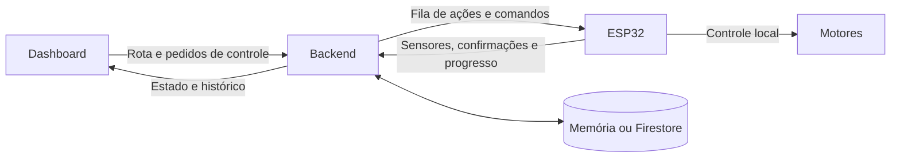

# Relatório de alterações: carrinho, backend e banco de dados

**Data:** 03/11/2026.  
**Escopo:** alterações realizadas nesta integração, presentes no workspace.  
**Situação:** software implementado e validado localmente; configuração da rede,
gravação e calibração do carrinho ainda dependem do ambiente físico.

Este relatório descreve o código efetivamente implementado. Diferencia alterações
novas de recursos que o backend já possuía e passou a utilizar com o firmware.
Não representa um deploy: nenhum banco remoto foi migrado ou inspecionado nesta
entrega. Os testes executados usaram armazenamento em memória.

## 1. Mudança principal

O carrinho passou a receber uma rota e comandos pela rede, mantendo as decisões
rápidas dos motores no ESP32. O backend coordena a missão e registra o que o
dispositivo confirma. A dashboard solicita as operações e apresenta seus resultados.

| Aspecto | Firmware original `carrinho_simples` | Primeiro `carrinho_autonomo`, antes da integração | `carrinho_autonomo` integrado |
|---|---|---|---|
| Decisão dos motores | Backend devolve potências | ESP32 decide localmente | ESP32 decide localmente |
| Comunicação | Sensores por HTTP | Ausente | Rota, comandos, sensores e confirmações por Wi-Fi/HTTP |
| Início | Depende do backend | Automático após 3 s e linha válida | Espera 3 s, conecta e aguarda rota + Iniciar |
| Cruzamentos | Backend processa | Para com os dois laterais ativos | Executa a ação da rota e confirma o trecho |
| Rotas pela dashboard | Usa o controlador remoto existente | Não disponíveis | Carregadas no ESP32 e executadas localmente |
| Dependência da rede para corrigir a linha | Uma resposta por ciclo | Nenhuma | Correção local, com comunicação em tarefa separada |

O arquivo original `firmware/carrinho_simples/carrinho_simples.ino` foi preservado.
O único arquivo que precisa ser gravado para o novo modo é
[`carrinho_autonomo.ino`](../firmware/carrinho_autonomo/carrinho_autonomo.ino).



O ESP32 não acessa o banco diretamente. Alimentação pela bateria dispensa o cabo
USB durante a operação; o servidor continua precisando estar acessível pela rede.

## 2. Inventário dos arquivos

Os caminhos são relativos à raiz do repositório. Arquivos marcados como novos
foram criados durante este trabalho; os demais foram modificados.

### 2.1. Firmware

| Arquivo | Alteração | Efeito |
|---|---|---|
| `firmware/carrinho_autonomo/carrinho_autonomo.ino` — novo no repositório | Criado inicialmente como seguidor local e ampliado para execução de rotas e rede | Um único sketch contém sensores, motores, estados, eventos, autenticação e comunicação |
| `firmware/carrinho_autonomo/README.md` — novo | Guia de configuração, operação, calibração e recuperação | Documenta o uso na bateria e as dependências reais |

### 2.2. Backend

| Arquivo | Alteração | Efeito |
|---|---|---|
| `backend/src/domain/types.ts` | Campo opcional `RobotDoc.controller` | Identifica o controlador ativo no documento do robô |
| `backend/src/services/device.ts` | Reconhece o controlador local, protege a troca de modo, limpa estado antigo, ajusta consulta ociosa, limpa bateria fictícia e detecta rota órfã | Alinha o protocolo existente ao novo sketch |
| `backend/src/services/operator.ts` | Permite parar com start/resume pendente; expira pedidos de movimento substituídos por stop/abort | Reduz conflitos entre comandos ainda não confirmados |
| `backend/src/services/sensor-control.ts` | Registra o modo antigo e recusa assumir missão do controlador local | Mantém compatibilidade com o firmware original |
| `backend/src/config.ts` | Padrão de `SEED_PROFILE`: `demo` → `clean` | Banco novo não inicia com missões de demonstração por padrão |
| `backend/.env.example` | Exemplo usa `RB-01`, informa HMAC e define `SEED_PROFILE=clean` | Facilita alinhar cadastro e segredo com o sketch |
| `backend/package.json` | Script `dev:local` | Inicia o backend carregando `.env` explicitamente |
| `backend/test/config.test.ts` | Verifica o padrão `clean` | Protege a configuração de bancada |
| `backend/test/autonomous-firmware.test.ts` — novo | Oito testes de integração do modo autônomo | Cobre limites, F/D/E, duplicatas, compatibilidade, paradas pendentes e reconciliação |
| `backend/README.md` e `backend/DEV.md` | Apontam o fluxo implementado e diferenciam documentação histórica | Atualizam configuração e uso do seed |

### 2.3. Dashboard

| Arquivo | Alteração | Efeito |
|---|---|---|
| `dashboard/src/components/robots/ExecutionPanel.tsx` — novo | Painel com comandos, conexão, sensores, progresso e recuperação | Operação acompanhada do carrinho |
| `dashboard/src/services/controlService.ts` — novo | Cliente dos endpoints de controle, estado, comandos e encerramento administrativo | Integra os botões ao backend real |
| `dashboard/src/pages/RoutePlanner.tsx` | Orientação inicial, confirmação da origem, prévia, carregamento e painel de execução | Distingue registrar uma rota de iniciá-la |
| `dashboard/src/services/routesService.ts` | Chaves de idempotência, orientação, confirmação de posição, prévia e tratamento específico de 404 | Corrige a integração do planejador com os contratos existentes |
| `dashboard/src/types/index.ts` | Tipos de missão, dispositivo, comando e extensões da rota | Permite apresentar o estado detalhado devolvido pela API |
| `dashboard/src/services/api.ts` | Leitura opcional de `import.meta.env` | Permite executar os serviços nos testes Node sem o ambiente Vite |
| `dashboard/vite.config.ts` | Proxy `/api`, padrão `http://127.0.0.1:8080`, configurável por `BACKEND_PROXY_URL` | Simplifica a ligação local entre navegador e backend |
| `dashboard/.env.example` | URL padrão `/api` | Usa o proxy durante desenvolvimento |
| `dashboard/package.json` | Comando `test` com Node e tsx | Executa a suíte dos serviços HTTP |
| `dashboard/test/control.test.ts` — novo | Seis testes dos serviços | Valida idempotência, erros, sessão, posição, prévia e referências de retomada |

### 2.4. Documentação geral

| Arquivo | Conteúdo |
|---|---|
| `README.md` | Aponta o firmware integrado e preserva a referência ao original |
| `docs/PLANO_INTEGRACAO_CARRINHO_AUTONOMO.md` — novo | Plano e registro da decisão de manter a implementação no mesmo `.ino` |
| Este relatório — novo | Inventário, impacto no backend, persistência, migração e limites da validação |
| `docs/FIRESTORE_MODEL.md` | Nota sobre a diferença entre a proposta histórica e o armazenamento efetivamente usado |

Os diretórios de build e os serviços temporários usados na validação são
artefatos de desenvolvimento. Não fazem parte do programa gravado no ESP32.

## 3. Comportamento implementado no ESP32

### 3.1. Inicialização e execução

O sketch mantém pinagem e funções de acionamento dos motores, além das correções
suaves/fortes. Acrescenta uma fila de até **16 ações**, com `F`, `D` e `E`.
Marcha à ré (`T`) não é suportada nesta versão.

Cada ação termina no próximo cruzamento. As fases locais são alinhamento,
curva, saída do cruzamento e seguimento do trecho. A partida não é contada como
uma nova chegada. As curvas exigem abandonar a linha anterior e reencontrar a
nova; o tempo limite provoca falha, não confirma chegada.

| Parâmetro | Valor inicial | Consequência |
|---|---|---|
| Espera ao ligar | 3 s | Motores parados; depois ainda aguarda autorização de início |
| Espera entre leituras | 10 ms | Cadência local aproximada, acrescida do processamento |
| Filtro | 3 leituras iguais | Confirma mudanças de direção e leituras usadas nas fases |
| Alinhamento antes da curva | 120 ms | Precisa de ajuste na montagem |
| Mínimo antes de aceitar nova linha na curva | 180 ms | Evita aceitar imediatamente a referência anterior |
| Limite de curva | 2,5 s | Falha se a manobra não for confirmada |
| Limite por fase de trecho/alinhamento | 15 s | Impede movimento indefinido sem confirmação |
| Sem comunicação válida | 30 s | Segura no próximo limite de trecho; vetos locais podem parar antes |
| Fila local de eventos | 12 entradas | Conserva confirmações pendentes e limita uso de memória |

O firmware conserva os eventos até confirmação; ao acumular eventos, segura
antes de iniciar outro trecho. Uma fila cheia coloca o controlador em falha.
Perda de linha fora da curva bloqueia imediatamente. Reencontrar a linha não
retoma sozinho. Pausar mantém a fase na RAM; retomar pressupõe que o carrinho não
foi reposicionado manualmente. Reiniciar perde a fila e a fase local.

### 3.2. Comunicação

A tarefa de rede faz o HTTP enquanto o loop principal controla os motores.
Somente o loop aplica comandos e escreve nas saídas dos motores. A troca entre
tarefas usa cópias, fila de respostas, mutex e relógio de contato atômico.

O sketch usa `POST /device/hello` para apresentar a sessão e
`POST /device/events` para enviar telemetria/eventos e receber comandos na resposta.
**Ele não chama `GET /device/poll` periodicamente**; esse endpoint continua
disponível para o protocolo e simulador existentes.

A autenticação HMAC-SHA256 já exigida pelo backend foi implementada no firmware.
São enviados ID do dispositivo, sessão, sequência, timestamp e assinatura do
corpo. O relógio é sincronizado por NTP; HTTPS exige configurar a CA do servidor.
Pedidos vencidos de movimento são recusados. O sketch usa a ordem dos IDs
`cmd-NNNN` produzidos pelo backend para evitar reaplicar comandos antigos e dá
prioridade a stop/abort dentro da mesma resposta.

O sketch cria uma cópia da telemetria aproximadamente a cada 100 ms para a tarefa
de rede. Isso **não** significa dez envios HTTP por segundo nem dez gravações
de sensores por segundo no banco.

## 4. Impacto no backend e nos endpoints

### 4.1. Recursos reaproveitados

Não foi criado um protocolo paralelo nem um novo endpoint de controle. Já
existiam planejamento de rotas, missões, comandos, autenticação, sessões,
confirmações, eventos, projeções e reconciliação. A integração usa esses recursos.
Os schemas compartilhados em `contracts/src` não foram alterados nesta entrega.

| Endpoint existente | Uso na integração |
|---|---|
| `POST /device/hello` | Registra sessão, firmware, capacidades e modo de controle |
| `POST /device/events` | Recebe eventos/telemetria e devolve comandos |
| `GET /device/poll` | Preservado; usado pelo simulador e outros clientes do protocolo |
| `POST /device/sensors` | Preservado para o firmware original, que recebe PWM do backend |
| `POST /api/robots/:id/route/preview` | Valida e traduz a rota antes de registrá-la |
| `POST /api/robots/:id/position` | Confirma origem e orientação do carrinho parado |
| `POST /api/robots/:id/route` | Cria a missão, a rota e o comando de carregamento |
| `POST /api/missions/:id/start`, `/stop`, `/resume`, `/abort` | Registra pedidos assíncronos de controle |
| `GET /api/commands/:id` | Consulta resultado do pedido |
| `GET /api/missions/:id/execution` | Consulta progresso e bloqueios |
| `GET /api/devices/:id/status` | Consulta sessão, conexão e última telemetria |
| `POST /api/missions/:id/force-close` | Encerramento administrativo de missão incerta |

### 4.2. Alterações efetivas das regras

1. **Modo de controle:** o hello marca `local-route`; o endpoint antigo de
   sensores marca `sensor-http`. Uma missão ativa impede alternar entre eles.
   Documentos antigos com `sensorControl`, mas sem `controller`, também são
   reconhecidos como controle remoto ao tentar migrar para o modo local.
2. **Consulta em repouso:** firmware com versão iniciada por `autonomo-` recebe
   `nextPollMs` ocioso limitado a 3000 ms. Em missão, segue `POLL_ACTIVE_MS`, cujo
   padrão é 1500 ms. Outros firmwares mantêm o intervalo ocioso configurado.
3. **Parada com movimento pendente:** pode solicitar stop mesmo antes de receber
   confirmação de start/resume. O servidor expira os pedidos de movimento
   substituídos e registra a razão `SUPERSEDED_BY_STOP`.
4. **Entrega de stop:** o comando continua entregável em `ready`, `running`,
   `blocked`, `paused` e `uncertain`, conforme seu estado e validade. Isso não
   transforma todo pedido de stop em transição para `paused`: a aplicação da
   confirmação continua respeitando a máquina de estados existente.
5. **Bateria:** hello de `autonomo-...` grava `batteryPercent = null`, pois o
   firmware não mede carga. Evita apresentar o valor do seed como medição real.
6. **Rota órfã:** quando o ESP informa uma missão que o servidor não encontra,
   ou que pertence a outro robô, o hello pede reconciliação. A memória do
   dispositivo não é usada para inventar uma missão no banco.
7. **Seed:** `clean` passa a ser padrão. `demo` continua disponível por
   configuração explícita. O novo script local carrega o `.env`.

Uma resposta HTTP 202 continua significando pedido registrado. O resultado do
comando só muda após confirmação, recusa, expiração ou tratamento de incerteza.
O backend não passa a medir rotação, velocidade ou posição física absoluta.

## 5. Impacto no banco de dados

### 5.1. Armazenamento real e diferença da documentação antiga

O código utiliza uma interface `Store`, com implementações em memória e Firestore.
**Robô e runtime do dispositivo ficam juntos em `robots/{id}`.** O endpoint
`/api/devices/:id/status` consulta esse documento; o nome da URL não implica uma
coleção `devices`.

A tabela histórica de `docs/FIRESTORE_MODEL.md` descreve parte de uma proposta
com `devices/{id}` separado. Para o estado implementado, as fontes são
[`store/types.ts`](../backend/src/store/types.ts),
[`domain/types.ts`](../backend/src/domain/types.ts) e os serviços que persistem os dados.
Também existe `routes`, usada pelas rotas registradas em tempo de execução.

Não houve criação de uma nova coleção, troca de banco, alteração de índices
compostos ou alteração de regras de acesso nesta integração. O campo novo é
lido após carregar o robô pelo ID, sem nova query filtrando por `controller`.

### 5.2. Mudanças em `robots/{robotId}`

| Campo | Situação | Efeito ao usar o novo firmware |
|---|---|---|
| `controller` | **Novo e opcional** | `local-route` no hello; `sensor-http` no caminho antigo |
| `sensorControl` | Já existia | Removido ao aceitar a migração para o protocolo local; o controlador antigo continua usando-o |
| `batteryPercent` | Já existia | Passa a `null` no hello de `autonomo-...` |
| `firmwareVersion` | Já existia | Recebe `autonomo-1.0.0` |
| `capabilities` | Já existia | Passa a refletir 16 ações, mensagem de 4096 bytes e ausência de marcha à ré |
| `sessionId`, `lastHelloTs`, `lastRequestSeq`, `ackedSeq` | Já existiam | Acompanham sessão, requisições e eventos do novo firmware |
| `deviceState`, `lastSeenAt`, `live` | Já existiam | Recebem estado e telemetria confirmados pelo protocolo |
| `currentPoint`, `heading`, `positionConfidence` | Já existiam | Origem confirmada pelo operador; depois posição lógica estimada pelos trechos |
| `activeMissionId`, `currentRouteId`, `pendingCommandIds` | Já existiam | Mantêm reserva do robô, referência de rota e controle das pendências |

Exemplo parcial, ilustrativo, depois de um hello e antes de movimento:

```json
{
  "id": "RB-01",
  "controller": "local-route",
  "firmwareVersion": "autonomo-1.0.0",
  "protocolVersion": 1,
  "batteryPercent": null,
  "capabilities": {
    "supportsReverse": false,
    "maxActions": 16,
    "maxMessageBytes": 4096
  },
  "deviceState": "ready"
}
```

O exemplo omite os demais campos; não deve substituir um documento inteiro.
`sensorControl` fica ausente no modo local, e não simplesmente preenchido com
zeros. O adaptador Firestore usa `set` sem merge para o documento carregado e
atualizado, portanto essa remoção também se reflete na persistência.

O token do dispositivo continua na configuração do servidor e no firmware.
Não foi acrescentado um campo para gravar o segredo em `robots`.

### 5.3. Coleções existentes afetadas pelo fluxo

| Coleção | Operação durante a execução | Mudança estrutural nesta entrega |
|---|---|---|
| `robots` | Sessão, modo, capacidades, telemetria, posição lógica e pendências | Novo campo opcional `controller` |
| `routes` | Guarda percurso, ações, orientação e vínculo da missão | Nenhuma |
| `missions` | Estado, ações concluídas, nó confirmado, bloqueios, falhas e encerramento | Nenhuma |
| `commands` | Carregamento/start/stop/resume/abort, entrega, tentativas e resolução | Nenhuma; novo uso do valor de razão `SUPERSEDED_BY_STOP` |
| `events` | Histórico projetado de comandos, transições e progresso | Nenhuma |
| `deviceEvents` | Evento crítico bruto com ID determinístico para deduplicação | Nenhuma |
| `idempotency` | Resultado anterior de uma intenção do operador | Nenhuma; dashboard passou a enviar as chaves exigidas |
| `alerts` | Falhas, incerteza e demais alertas do processamento existente | Nenhuma |
| `rollups` | Agregações de missões e paradas pelo consumidor existente | Nenhuma |
| `counters` | Próximos IDs de missão, rota e comando | Nenhuma |
| `maps/{mapId}/versions/{n}` | Consulta e validação do percurso | Nenhuma |

O firmware não cria um documento por leitura de GPIO. Telemetria é um snapshot
em `robots.live`; eventos críticos possuem registro próprio em `deviceEvents`.
`action_started` pode gerar histórico projetado, mas não é evento crítico bruto.

### 5.4. Escritas por operação

| Operação | Efeitos persistidos principais |
|---|---|
| Apresentação do ESP32 | Atualiza `robots`; pode reconciliar missão e pendências existentes |
| Confirmar origem | Atualiza posição, orientação e confiança em `robots` |
| Registrar rota | Cria `routes`, `missions`, comando `load_route` e idempotência; atualiza robô, contadores e histórico |
| Pedir start/stop/resume/abort | Registra comando, idempotência e histórico; atualiza pendências; pode expirar comandos anteriores |
| Confirmar comando | Resolve `commands`, retira pendência e atualiza missão/histórico conforme a operação |
| Confirmar trecho | Incrementa progresso e atualiza nó/orientação lógica; registra eventos |
| Terminar missão | Encerra missão, libera reserva, registra histórico e permite atualizar agregações |
| Encerrar missão incerta | Marca encerramento sem confirmação, expira pendências e torna a confiança de posição desconhecida |

As operações continuam transacionais. A camada `BufferedTx` agrupa alterações
do mesmo documento em um commit; várias chamadas `tx.set` para o mesmo robô
na mesma transação não significam várias escritas finais desse documento.

### 5.5. Volume de requisições, leituras e escritas

O controle local elimina a necessidade de enviar cada correção de motor ao
servidor. Porém, o uso atual de `/device/events` ainda tem um caminho frequente
de persistência que precisa ser considerado antes de operar continuamente em Firestore.

| Situação idealizada de um robô conectado | Intervalo | Aproximação de requisições por hora |
|---|---|---|
| Missão ativa, configuração padrão | 1,5 s | 2400 |
| Ocioso com este firmware | 3 s | 1200 |

São estimativas aritméticas, sem atrasos, falhas ou mudanças de configuração.
Não são medição de uso nem previsão de cobrança.

Pontos do código que determinam o impacto:

1. A autenticação de uma requisição válida lê o documento do robô. O serviço de
   eventos volta a lê-lo dentro da transação. Há leituras adicionais conforme
   os eventos e os comandos pendentes.
2. A atualização de `robots.live` ocorre quando muda o estado/bloqueio ou após
   aproximadamente 5 s. Isso limita a substituição do snapshot dos sensores.
3. **Esse limite não elimina a escrita de `robots` em cada envio de eventos.**
   `handleEvents` chama `collectCommands`, que termina com `tx.set(C.robots, ...)`
   mesmo sem comandos pendentes. Uma transação válida de eventos normalmente
   grava o documento do robô, ainda que o snapshot dos sensores não tenha mudado.
4. Portanto, no cenário idealizado, há aproximadamente 2400 ou 1200 commits por
   hora no documento do robô por esse caminho, além das outras coleções afetadas.
   Repetições de transações, falhas e outros acessos podem alterar o volume.
5. A otimização de `GET /device/poll` que evita escritas quando nada mudou não
   beneficia automaticamente este sketch, pois ele envia `/device/events`.
6. Comandos pendentes podem ser entregues novamente antes do ack, atualizando
   tentativas e gerando acessos adicionais; o dispositivo evita reaplicar o movimento.
7. A dashboard consulta dispositivo, rota, execução e eventual comando a cada
   2 s enquanto o painel está aberto. Múltiplos operadores/abas acrescentam leituras.

**Impacto prático:** o volume é bem diferente do controle remoto de motor por
amostra, mas a integração não deve ser descrita como “uma escrita a cada 5 s”.
Se a meta for reduzir operações em Firestore, fica como evolução separar a
cadência de telemetria da consulta de comandos ou condicionar a escrita do robô
a mudanças efetivas. Essa otimização não foi implementada nesta entrega.

### 5.6. Retenção

Nenhum prazo ou política de TTL foi alterado. No código atual, há campos
`expireAt` para eventos brutos críticos (30 dias), histórico projetado (180 dias),
idempotência (1 dia) e comandos (8 dias a partir da criação).

Esses valores descrevem a implementação, inclusive quando diferem de descrições
históricas de “7 dias após resolver comando”. A remoção automática no Firestore
depende das políticas de TTL configuradas no ambiente. Nenhuma política remota
foi criada ou verificada neste trabalho.

## 6. Compatibilidade e migração

Não há migração SQL nem script de alteração em massa. O campo `controller` é
opcional e é preenchido ao usar cada caminho do protocolo. A limpeza de
`sensorControl` acontece ao aceitar o hello no modo local.

Procedimento operacional para um robô que usava o firmware antigo:

1. Finalizar a missão ativa e confirmar que o carrinho está parado.
2. Configurar o novo backend e o sketch com o mesmo ID e segredo.
3. Gravar o sketch e verificar a apresentação da nova sessão.
4. Conferir `controller = local-route`, capacidades, versão e bateria sem leitura.
5. Reposicionar e confirmar origem/orientação antes de carregar a próxima rota.

Uma tentativa de trocar o controlador durante missão ativa é recusada com
`CONFLICT_STATE`. O campo removido é estado operacional antigo, não o histórico
das missões. Não foram apagadas coleções ou rotas históricas para fazer a migração.

**Atenção ao seed:** mudar o padrão para `clean` não limpa um banco existente.
O bootstrap verifica se já há robôs antes de semear. Um banco previamente
populado com demonstração continua com esses dados; usar um ambiente limpo ou
planejar a separação desses registros é uma decisão operacional posterior.
No modo Firestore, `SEED_ON_BOOT` é desativado por padrão: escolher o perfil
`clean` sozinho também não cadastra automaticamente os robôs no banco remoto.

Para voltar ao firmware original, também finalize a missão e faça a troca com
o carrinho parado. Retornar apenas a versão do backend pode remover as proteções
novas de modo de controle e comandos pendentes; não deve ser tratado como uma
migração automática dos dados.

## 7. Memória, Firestore e recuperação

| Aspecto | `STORE=memory` | `STORE=firestore` |
|---|---|---|
| Persistência após reinício do servidor | Perde dados de runtime e histórico em memória | Mantém documentos confirmados no banco |
| Uso validado nesta entrega | Sim | Não executado contra banco real ou emulador |
| Autenticação de operador | `AUTH_MODE=off` admitido para desenvolvimento | Configuração exige autenticação apropriada; `off` é recusado |
| Efeitos sobre um banco remoto nesta entrega | Nenhum | Nenhum deploy, alteração de regras, índices ou TTL |

Se o servidor em memória perder a rota, o ESP pode ainda lembrar da execução na
RAM. O novo tratamento solicita reconciliação e o firmware segura o movimento.
Ele não recria o histórico perdido nem retoma automaticamente a rota.

Se o ESP32 reiniciar durante uma missão, perde a fila e a fase da curva. O
backend pode conservar a missão e o último nó lógico, mas isso não prova a
posição física. A dashboard oferece encerramento administrativo da missão
incerta após reiniciar/conferir o carrinho, seguido de nova confirmação de origem.
Esse encerramento registra `closedWithoutConfirmation`, deixa a duração
desconhecida e não equivale a uma parada física confirmada.

## 8. Validação realizada

Os resultados abaixo correspondem à entrega da integração; não foi necessário
reexecutar suítes para produzir este relatório documental.

| Verificação | Resultado e alcance |
|---|---|
| Compilação ESP32 com partição `no_ota` | Passou; aproximadamente 1,06 MB de programa e 49,5 KB de variáveis globais |
| Backend: testes | 142 passaram, incluindo os oito testes novos do modo autônomo |
| Contratos: testes | 231 passaram |
| Serviços da dashboard: testes | Seis passaram |
| Tipos/builds de backend e dashboard | Passaram |
| Contrato contra servidor HTTP real | 53 verificações passaram; cinco dependentes de credenciais não foram executadas no modo local |
| Fluxo HTTP e proxy da dashboard com simulador | Carregar → iniciar → parar → retomar → F/D/E → concluir, sem duplicar progresso |
| Execução do firmware em hardware | Pendente |
| Calibração de sensores, potência e curvas na pista | Pendente |
| Teste automatizado da interface em navegador | Não realizado; testes da dashboard cobrem os serviços HTTP |
| Firestore real/emulador e autenticação real de produção | Não validados nesta entrega |

Os testes com simulador validam a integração do protocolo e o backend. A
compilação do `.ino` valida sua construção para ESP32. Esses resultados não
comprovam a execução física das manobras nem uma configuração de nuvem já implantada.

## 9. Condições para colocar em operação

- Configurar Wi-Fi, URL, ID, segredo, NTP e CA quando usar HTTPS.
- Disponibilizar o backend na rede e escolher conscientemente memória ou persistência.
- Usar a dashboard real com `VITE_DEMO` desativado e o endereço correto da API.
- Gravar o único `.ino` e verificar sentidos dos motores, sensores e curvas.
- Validar perda de linha, desconexão, reinício, parada, retomada e chegada na pista.
- Antes de uso contínuo em Firestore, validar adaptador, índices/políticas do
  ambiente e frequência efetiva de acesso descrita neste relatório.

Guia de configuração e operação:
[`firmware/carrinho_autonomo/README.md`](../firmware/carrinho_autonomo/README.md).

## 10. Fontes para manutenção

- [Firmware integrado](../firmware/carrinho_autonomo/carrinho_autonomo.ino).
- [Serviço de dispositivo](../backend/src/services/device.ts).
- [Serviço de comandos do operador](../backend/src/services/operator.ts).
- [Controlador remoto original](../backend/src/services/sensor-control.ts).
- [Documentos internos](../backend/src/domain/types.ts).
- [Coleções e interface Store](../backend/src/store/types.ts).
- [Adaptador Firestore](../backend/src/store/firestore.ts) e [transações agrupadas](../backend/src/store/buffered.ts).
- [Painel de execução](../dashboard/src/components/robots/ExecutionPanel.tsx).
- [Testes novos de integração](../backend/test/autonomous-firmware.test.ts).

O relatório descreve a versão local analisada em 03/11/2026. Mudanças posteriores
de firmware, cadência, protocolo ou armazenamento exigem revisar seus impactos.
