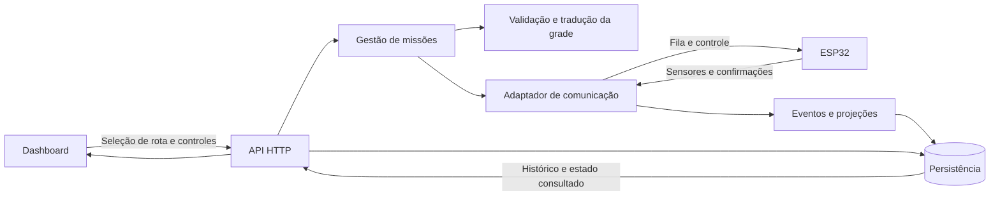

# Backend RoboFlow — documentação técnica para implementação futura

> **Aviso (26/10/2026):** a arquitetura de nuvem — **Cloud Run, poll HTTPS do ESP32, Firestore, Pub/Sub** — **supera** as seções deste documento que tratam de serial USB, backend no computador do operador, heartbeat/expiração de 250 ms / 1.000 ms e "stack/banco não escolhidos". Essas seções continuam abaixo, marcadas como **SUPERADAS**, só como histórico. Convenção de coordenadas: **y para baixo** (§4–§5 atualizadas). Decisões em [docs/adr/0001 a 0005](../docs/adr) (e [0008](../docs/adr/0008-um-start-resume-pendente-por-vez.md)); modelo de dados em [docs/FIRESTORE_MODEL.md](../docs/FIRESTORE_MODEL.md); contrato executável em [contracts/](../contracts).

**Estado:** especificação; o backend ainda não foi implementado. Esta pasta contém somente documentação. Atualizado em 21/10/2026.

Este documento descreve o comportamento esperado, os dados, as interfaces e os critérios para construir o backend. Exemplos de mensagens e endpoints novos são contratos propostos para implementação, não recursos disponíveis para uso.

## 1. Objetivo

O backend conecta a dashboard ao carrinho. Recebe a seleção de uma rota, valida os pontos da grade, traduz o percurso para uma fila `F/T/D/E`, envia essa fila ao ESP32 e acompanha a execução. Também armazena missões, eventos, paradas e alertas e calcula os indicadores exibidos na interface.

O processamento de rotas e as decisões de missão ficam no backend. A leitura dos sensores, o seguimento rápido da linha, a execução das ações e a autorização final dos motores ficam no ESP32.

Não há medição de velocidade, encoders ou localização absoluta na configuração atual. Coordenadas são posições lógicas na grade; o progresso é estimado a partir da origem conhecida e dos cruzamentos confirmados.

## 2. Referências e situação do repositório

| Documento / código | Referência |
|---|---|
| [Plano do backend](../docs/PLANO_BACKEND_ROBOFLOW.md) | Decisões, etapas de entrega e pendências físicas |
| [Arquitetura dos componentes](../docs/ARQUITETURA_DOS_COMPONENTES.md) | Hardware, pinagem, alimentação e supervisor |
| [O que o robô faz](../docs/O_QUE_O_ROBO_FAZ.md) | Funcionamento e grade no chão |
| [Documentação do compilador](../compiler/DOCUMENTACAO_COMPILADOR_ROBOFLOW.md) | Geração futura do sketch completo para Arduino IDE |
| [Contrato de integração da dashboard](../dashboard/BACKEND_INTEGRATION.md) | Formatos HTTP já consumidos pelo frontend |
| [Tipos do frontend](../dashboard/src/types/index.ts) | Campos e enums das respostas existentes |
| [Serviços HTTP](../dashboard/src/services/api.ts) | URL base, envelope e tratamento de erros |

O contrato HTTP e os tipos existentes devem ser preservados. O plano apresenta a ordem de trabalho; este README detalha a implementação futura. Alterações nos contratos compartilhados deverão atualizar ambos os documentos e os clientes afetados.

Atualmente há lexer, parser, AST, exemplos RoboFlow e uma dashboard. Não há servidor backend, banco configurado, protocolo operacional integrado ou firmware gerado executando esse fluxo. Seleção de rota e controles operacionais ainda exigem mudanças no frontend.

> **SUPERADO (ADR 0001, 0003):** ~~Stack, banco e transporte sem cabo ainda não foram escolhidos.~~ Escolhidos: Cloud Run (TypeScript), Firestore nativo e poll HTTPS do ESP32. Este documento não apresenta comandos de instalação de um servidor inexistente.

Stack, banco e transporte sem cabo ainda não foram escolhidos. Este documento não apresenta comandos de instalação de um servidor inexistente.

## 3. Arquitetura e responsabilidades



| Componente | Deve fazer |
|---|---|
| Dashboard | Selecionar rota, mostrar prévia e progresso, solicitar início/parada/retomada e apresentar avisos |
| Backend | Validar e traduzir a rota, coordenar missões, enviar comandos, receber eventos e persistir dados |
| ESP32 | Ler sensores, executar fila por fases, corrigir linha, confirmar cruzamentos e impedir movimento bloqueado |
| Compilador | Gerar um sketch `.ino` completo com o sistema embarcado |

O backend não compila nem grava o ESP32 como parte da seleção de rota. O operador grava o sketch pela Arduino IDE antes da operação. A rota muda em tempo de execução por mensagens.

Avisos equivalentes a `signal_light`, `signal_buzzer` e logs são apresentados visualmente na dashboard. Não é obrigatório instalar buzzer ou LEDs externos para esse fluxo.

## 4. Grade, posição e orientação

A pista é uma grade de linhas e colunas desenhada no chão. Cada cruzamento é um nó `(x,y)` e cada trecho percorrido conecta dois cruzamentos vizinhos consecutivos.

Convenção adotada ([ADR 0004](../docs/adr/0004-eixo-de-coordenadas.md)), compartilhada com o planejador e com a dashboard:

- Coordenadas 0-indexadas, origem `(0,0)` no canto superior esquerdo: `x` aumenta para a direita (leste) e `y` aumenta para **baixo** (sul).
- Coordenadas são inteiras, com incremento de uma unidade por cruzamento.
- Orientação do chassi: `N=(0,-1)`, `E=(+1,0)`, `S=(0,+1)`, `W=(-1,0)`.
- Orientação `E` significa leste; comando `E` significa esquerda.
- Identificador de nó: `"x,y"`.
- Conexões físicas são cadastradas explicitamente, inclusive sentidos permitidos e trechos indisponíveis.

Antes de iniciar, o operador confirma o cruzamento e a orientação inicial do carrinho. O backend não deve supor que ele está na origem de uma missão anterior.

Uma rota de `(0,0)` até `(0,2)` deverá incluir `(0,1)`. O contrato do executor é por cruzamento, portanto não enviar um comando que salte um ponto intermediário. Cada trecho deve satisfazer `abs(dx) + abs(dy) = 1` e existir no mapa cadastrado.

### 4.1 Modelo de mapa e rota

```json
{
  "id": "pista-1",
  "version": 1,
  "nodes": [
    {"id":"A","x":0,"y":3},
    {"id":"B","x":0,"y":2},
    {"id":"C","x":1,"y":2},
    {"id":"D","x":1,"y":1}
  ],
  "edges": [
    {"from":"A","to":"B"},
    {"from":"B","to":"C"},
    {"from":"C","to":"D"}
  ]
}
```

O exemplo omite o restante da grade por brevidade. Arestas são dirigidas; caminho de volta precisa de aresta própria.

```json
{
  "id":"rota-carga",
  "version":1,
  "name":"Origem até carga",
  "mapId":"pista-1",
  "mapVersion":1,
  "initialHeading":"N",
  "nodeIds":["A","B","C","D"]
}
```

No MVP, o frontend seleciona rotas já cadastradas. O backend recupera os pontos pelo mapa; não trata coordenadas arbitrárias recebidas como percurso autorizado. Cadastro inicial pode ser feito por dados de configuração/migração. Editor visual e endpoints de edição de mapas não são requisitos do primeiro incremento.

Versões de mapa e rota usadas por uma missão devem ser imutáveis. Alteração posterior no cadastro não altera a fila de uma missão em execução.

## 5. Tradução de rota para F/T/D/E

**Cada comando termina no próximo cruzamento.** D/E incluem a curva no cruzamento atual e o avanço até o seguinte.

| Comando | Movimento | Orientação do chassi ao concluir |
|---|---|---|
| F | Avançar até o próximo cruzamento | Mantida |
| D | Virar à direita e avançar até o próximo | Rotacionada 90° à direita |
| E | Virar à esquerda e avançar até o próximo | Rotacionada 90° à esquerda |
| T | Ir de ré até o cruzamento atrás | Mantida |

Não enviar F adicional para completar D/E. T não é meia-volta. Seu destino não precisa ter sido visitado antes.

### 5.1 Algoritmo determinístico

```text
orientacoes = [N, E, S, W]
heading = orientacao_inicial

para cada par consecutivo (origem, destino):
    validar vizinhanca e aresta fisica
    rumo = N se delta=(0,-1), E se (+1,0),
           S se (0,+1), W se (-1,0)      # y cresce para baixo
    diferenca = (indice(rumo) - indice(heading) + 4) mod 4

    se diferenca == 0: comando = F
    se diferenca == 1: comando = D; heading = rumo
    se diferenca == 3: comando = E; heading = rumo
    se diferenca == 2: comando = T; heading permanece

    validar capacidade do dispositivo
    guardar comando, origem, destino, heading antes/depois
```

Para `A(0,3) → B(0,2) → C(1,2) → D(1,1)`, iniciando em N (y para baixo):

| Índice | Trecho | Rumo antes → depois | Comando |
|---|---|---|---|
| 0 | A → B | N → N | F |
| 1 | B → C | N → E | D |
| 2 | C → D | E → N | E |

Resultado: `["F","D","E"]`. Quatro pontos produzem três ações. A origem não conta como ação concluída. A implementação de referência é `translateRoute` em [contracts/src/geometry.ts](../contracts/src/geometry.ts).

O primeiro planejador valida e traduz uma sequência cadastrada; não precisa escolher automaticamente o menor caminho. Busca automática entre origem/destino pode ser adicionada depois, considerando orientação e capacidades para evitar rotas inexequíveis.

### 5.2 Validações antes de transmitir

Rejeitar rota sem deslocamento no MVP, nós inexistentes, pontos repetidos consecutivos, diagonais, saltos, arestas ausentes/bloqueadas, versões incompatíveis, orientação incorreta, fila acima do limite anunciado e ações não suportadas.

O protocolo reconhece T, mas o MVP proposto anuncia `supportsReverse=false`: não há cobertura traseira do ultrassom nem seguimento em ré validado. Retornar erro de capacidade e não substituir T silenciosamente por outra manobra. Habilitar essa capacidade depende de validação física.

## 6. Confirmação dos cruzamentos

O ESP32 executa cada item por fases: manobra/alinhamento no cruzamento inicial, saída da região atual, seguimento do segmento e confirmação da entrada no próximo cruzamento. Só após sair da região anterior a detecção de chegada pode ser rearmada.

O reconhecimento pelos três sensores, filtragem e referência de alinhamento ainda precisam ser calibrados. Uma leitura isolada `111` ou `101` não prova um cruzamento nem informa suas coordenadas.

O backend atualiza posição somente com confirmação válida de conclusão. Não avança por envio, `ack`, leitura isolada ou tempo decorrido. Enquanto há deslocamento, expor último cruzamento confirmado e próximo esperado, com `atNode=false`; não apresentar o carrinho como se já tivesse chegado.

Uma chegada intermediária não exige parada física, se a continuação estiver autorizada. Ao confirmar a última ação, o firmware desabilita motores e emite conclusão final. Timeout de ação gera parada/falha, não sucesso.

Se a contagem ou a referência forem perdidas, parar e marcar posição incerta. Os cruzamentos são iguais; a sequência não comprova localização após retirada manual do carrinho, reinício ou evento perdido. Retomada exige reconciliação ou reposicionamento confirmado.

## 7. Organização interna e persistência

Estrutura futura, não criada nesta entrega:

```text
backend/
  README.md
  api/             Endpoints e validação das requisições
  maps/            Grade, conexões e versões
  routes/          Rotas cadastradas e tradutor
  missions/        Estados e comandos operacionais
  devices/         Sessão, capacidades e reconciliação
  transport/       Adaptadores serial/rede
  telemetry/       Eventos, deduplicação e projeções
  alerts/          Avisos e reconhecimento
  persistence/     Repositórios, transações e migrações
  tests/           Simulador, domínio, protocolo e API
```

| Entidade | Campos essenciais / invariantes |
|---|---|
| MapVersion | ID/versão, nós com coordenadas únicas, arestas válidas |
| RouteVersion | ID/versão, mapa, nós ordenados e orientação |
| Device | ID, sessão atual, capacidades, última comunicação |
| Mission | Dispositivo, versões congeladas, estado e posição lógica |
| MissionAction | Missão/índice únicos, comando, origem/destino e resultado |
| DeviceCommand | ID, tipo, payload, sessão, validade, estado e tentativas |
| Event | ID, dispositivo/sessão/sequence, recepção UTC e payload |
| Alert | Motivo, severidade, ocorrências e reconhecimento |

Garantir uma missão ativa ou não reconciliada por dispositivo. Criação da missão, reserva e registro da ordem de envio devem ser transacionais. Um worker de saída só transmite comandos persistidos e ainda válidos; reiniciar o servidor não permite reproduzir automaticamente comandos de movimento vencidos.

Idempotência de criação HTTP: mesma chave e mesmo corpo retornam o resultado anterior; mesma chave e corpo diferente geram conflito. Deduplicação de eventos usa dispositivo/sessão/sequence. Log importado deduplica pelo ID canônico sem criar comandos nem alterar a execução ativa.

## 8. Máquina de estados da missão

| Estado interno | Significado | Próximas transições principais |
|---|---|---|
| queued | Missão persistida, dispositivo reservado | loading, failed, aborted |
| loading | Fila enviada, aguardando aceitação | ready, failed, uncertain, aborted |
| ready | Fila aceita, motores parados | running, aborted, failed, uncertain |
| running | Execução confirmada | blocked, paused, completed, failed, uncertain, aborted |
| blocked | Supervisor impede movimento | running após liberação aceita, aborted, failed, uncertain |
| paused | Parada solicitada e confirmada | running após liberação aceita, aborted, uncertain |
| completed | Última ação e parada final confirmadas | Terminal |
| aborted | Cancelamento e invalidação da fila confirmados | Terminal |
| failed | Falha terminal confirmada | Terminal |
| uncertain | Estado físico não reconciliado | Reconciliação por `snapshot`/`hello`: paused, blocked, completed, aborted, failed. Nunca volta a `running` sozinho. `force-close` (admin) leva a aborted |

> **Atualizado (26/10/2026, `contracts` 1.1.0):** a tabela inclui as transições `queued/loading/running → aborted` e `uncertain → completed/blocked`; a fonte executável é `MISSION_TRANSITIONS` em `contracts/src/mission.ts`.

Um pedido de start/resume/abort não muda o estado para seu resultado final até o ESP32 confirmar. Pedido pendente é registrado em `DeviceCommand` e exposto pela API.

O status público de `Mission` permanece compatível: estados ativos viram `in_progress`; completed/aborted/failed mantêm o valor; uncertain vira `indeterminate`. Estado detalhado vai em `/execution`. Enquanto incerta, a missão mantém a reserva do dispositivo até reconciliação ou encerramento explícito.

Registrar `startedAt` quando a missão entra no ciclo no backend e `motionStartedAt` separado quando houver movimento confirmado. Duração pública é o tempo total do ciclo, incluindo esperas. Estado terminal sem confirmação, por perda de comunicação, não deve inventar `endedAt` ou sucesso.

## 9. API HTTP existente

Base padrão de desenvolvimento esperada pelo frontend: `http://localhost:8080/api`, configurada por `VITE_API_URL`. O cliente possui timeout de 10 s. Operações físicas longas devem ser assíncronas, sem manter a requisição aberta aguardando o percurso.

Preservar os formatos completos do [contrato da dashboard](../dashboard/BACKEND_INTEGRATION.md):

| Método | Caminho | Resposta em `data` |
|---|---|---|
| GET | `/dashboard/metrics` | `DashboardMetrics` |
| GET | `/missions` | Array de `Mission`, eventos opcionais |
| GET | `/missions/:id` | `Mission` com eventos |
| GET | `/logs` | Array de `LogEvent`, mais recente primeiro |
| POST | `/logs/import` | `importedCount`, `ignoredCount` opcional |
| GET | `/alerts` | Array de `Alert` |
| PATCH | `/alerts/:id/acknowledge` | ID e `acknowledged=true` persistido |

Envelope padrão: `{ "success": true, "data": ... }`. Erros usam HTTP adequado e `{ "success": false, "message": "...", "error": "CODIGO" }`. Não retornar erro operacional como HTTP 200: o cliente atual decide falha principalmente pelo status HTTP.

Respeitar filtros já enviados: `period`, `startDate`, `endDate`, `origin`, `destination`, `status`, `search`, `missionId`, `eventType` e `severity`, conforme endpoint. Períodos personalizados devem validar início/fim. Usar instantes UTC e limite final exclusivo `[startDate,endDate)` como convenção a aplicar igualmente às métricas e listas.

As listas continuam arrays; não trocar silenciosamente por objeto paginado. Datas são ISO 8601. Configurar CORS para a origem da dashboard; desenvolvimento atual usa `http://localhost:3000`.

### 9.1 Eventos e métricas

Enums públicos já existentes:

```text
MissionStatus: completed, in_progress, aborted, failed, indeterminate
EventType: mission_start, command, state_change, presence_detected,
           stop_preventive, resume, destination_reached, mission_end,
           error, warning, unknown
RoverState: idle, moving, stopped, obstacle_hold, navigating, completed,
            error, unknown
Severity: info, warning, error, critical
```

Projetar eventos novos nesses enums e guardar detalhes em `payload`. Não enviar valores novos sem atualizar o contrato e os tipos do frontend.

- `action_started` gera `command`; obstáculo gera `presence_detected` e a transição de parada gera `stop_preventive`.
- `resume` só é emitido quando a retomada é aceita/efetiva.
- Conclusão física confirmada gera `destination_reached` e `mission_end`.
- Uma parada conta por transição para bloqueio, não por leitura repetida. Múltiplos motivos no mesmo bloqueio não multiplicam `totalStops`.
- `totalStops = presenceStops + otherStops + unknownStops`. Classificar cada episódio uma única vez; inicialmente presença se o motivo inicial inclui obstáculo, outro se conhecido, desconhecido nos demais casos.
- `completionRate = 100 × completedMissions / totalMissions`, com zero quando não houver missões. Durações são calculadas sobre missões concluídas com duração conhecida; sem amostra, retornar `null`.
- Reconhecimento de alerta altera apenas o alerta; não autoriza motor.

Eventos de dispositivo sem missão são armazenados com vínculo opcional interno e expostos em consulta do dispositivo. `/logs` atual exige `missionId`, então não inventar uma missão para encaixar inicialização/diagnóstico nesse endpoint.

## 10. Extensões HTTP para operação

Endpoints propostos; dependem de implementação e de telas/serviços adicionais:

| Método | Caminho | Função |
|---|---|---|
| GET | `/health` | Disponibilidade do serviço; diagnóstico |
| GET | `/maps/:id` | Mapa atual ou versão solicitada por `version` |
| GET | `/routes` | Rotas disponíveis |
| GET | `/routes/:id` | Rota atual ou versão solicitada |
| POST | `/routes/:id/preview` | Validar e traduzir sem movimento |
| GET | `/devices/:id/status` | Estado, sessão, sensores e bloqueios |
| GET | `/devices/:id/events` | Diagnóstico inclusive sem missão |
| POST | `/missions` | Criar missão e registrar carregamento da fila |
| GET | `/missions/:id/execution` | Índice, estado detalhado e comandos pendentes |
| POST | `/missions/:id/start` | Solicitar início de fila aceita |
| POST | `/missions/:id/stop` | Solicitar parada sem descartar progresso |
| POST | `/missions/:id/resume` | Solicitar retomada explícita |
| POST | `/missions/:id/abort` | Solicitar parada e descarte da fila |
| GET | `/commands/:id` | Consultar resultado assíncrono |

### 10.1 Prévia

Corpo de `POST /routes/rota-carga/preview`:

```json
{"routeVersion":1,"deviceId":"robo-1","initialNodeId":"A","initialHeading":"N"}
```

Resposta ilustrativa:

```json
{
  "success":true,
  "data":{
    "routeId":"rota-carga","routeVersion":1,"mapVersion":1,
    "nodeIds":["A","B","C","D"],
    "points":[{"x":0,"y":0},{"x":0,"y":1},{"x":1,"y":1},{"x":1,"y":2}],
    "actions":["F","D","E"],"finalHeading":"N","executable":true
  }
}
```

Prévia é informativa e não reserva dispositivo. A criação da missão revalida rota, versão, posição declarada e capacidades, mesmo que a prévia tenha sido aprovada.

### 10.2 Criar e controlar missão

`POST /missions`, com `Idempotency-Key`:

```json
{"routeId":"rota-carga","routeVersion":1,"deviceId":"robo-1","initialNodeId":"A","initialHeading":"N"}
```

Ao criar o recurso, retornar `201` com `missionId`, estado `queued` e ID do comando de carregamento. Carregar a fila não inicia motores.

Pedidos de start/stop/resume/abort levam chave de idempotência e a sessão de execução observada pelo cliente; resume deve incluir o ID do bloqueio exibido, para não liberar um bloqueio novo por uma tela antiga. Resposta de envio aceito:

```json
{"success":true,"data":{"commandId":"cmd-12","missionId":"MS-001","status":"pending"}}
```

Usar `202 Accepted` enquanto aguardando dispositivo. Consulta do comando expõe `pending`, `accepted`, `rejected`, `expired` ou `uncertain` e motivo. `accepted` confirma aplicação da transição de controle, não conclusão de uma ação da rota.

Erros previstos: `404` recurso inexistente, `409` conflito de estado/idempotência/sessão, `422` rota/parâmetros/capacidade inválidos, `503` dispositivo indisponível. Stop/abort sem conexão não podem alegar parada confirmada: registrar intenção de cancelamento e resultado incerto até reconciliar; usar watchdog local para expirar movimento. Start/resume sem conexão são rejeitados.

### 10.3 Estado operacional

```json
{
  "success":true,
  "data":{
    "missionId":"MS-001","deviceId":"robo-1","sessionId":"boot-7",
    "state":"blocked","actionIndex":1,"completedActions":1,"totalActions":3,
    "lastConfirmedNode":"B","expectedNode":"C","atNode":false,
    "positionConfidence":"estimated","headingAtLastConfirmedNode":"N",
    "blockId":"block-4","blockReasons":["obstacle"],
    "updatedAt":"2026-10-21T20:00:00.000Z"
  }
}
```

`actionIndex` é o item atual/próximo, começando em zero; ao concluir a fila, usar `null`. `completedActions` é a contagem confirmada. Não apresentar a orientação do último nó como orientação instantânea durante uma curva. Dados antigos devem exibir sua idade, sem afirmar conexão ao vivo.

## 11. Protocolo com o ESP32

### 11.1 Transporte e identificação — SUPERADA

> **SUPERADA pelo [ADR 0001](../docs/adr/0001-transporte-agv-nuvem.md):** o transporte é **HTTPS por poll** (`POST /device/hello`, `GET /device/poll`, `POST /device/events`), não serial USB, e o backend roda no Cloud Run, não no computador do operador. Os conceitos de envelope, sessão, sequência e limites continuam válidos; veja `contracts/src/device.ts`. O texto abaixo é histórico.

Proposta inicial de bancada: serial USB, 115200 baud, 8N1, uma mensagem JSON UTF-8 por linha terminada em `\n`. O backend utiliza a porta configurada; o Monitor Serial da Arduino IDE não pode ocupá-la simultaneamente.

Serial limita deslocamento por cabo. O transporte para operação sem cabo permanece a definir, mantendo os mesmos conceitos de sessão, confirmação e fila. Não presumir que a página estática da dashboard abra diretamente a serial ou envie comandos ao ESP32.

Envelope: `v`, `type`, `messageId`, `deviceId`, `sessionId`. Mensagens de missão incluem `missionId` e `routeRevision`. Sessão muda a cada boot, invalidando ordens antigas. Eventos do dispositivo incluem `sequence` monotônica dentro da sessão e `uptimeMs`.

Limites iniciais propostos: 64 ações e 4096 bytes por linha, anunciados no handshake; implementar leitura limitada e rejeitar excesso antes de executar. Limites finais dependem do teste de memória do firmware.

### 11.2 Handshake e carregamento

```json
{"v":1,"type":"hello","messageId":"evt-1","deviceId":"robo-1","sessionId":"boot-7","sequence":1,"uptimeMs":100,"capabilities":{"supportsReverse":false,"maxActions":64,"maxMessageBytes":4096},"state":"ready"}
```

O backend reconhece a sessão, compara a missão persistida e consulta o estado antes de transmitir. Nova sessão implica motores parados e nenhuma retomada automática.

```json
{"v":1,"type":"load_route","messageId":"cmd-10","deviceId":"robo-1","sessionId":"boot-7","missionId":"MS-001","routeRevision":1,"actions":["F","D","E"],"expectedNodes":["B","C","D"],"startNode":"A","initialHeading":"N"}
```

Fila é recebida e validada integralmente enquanto parado, com arrays de mesmo comprimento e ações suportadas. `expectedNodes` é metadado; não dá ao sensor capacidade de ler coordenadas. Alterar fila em movimento é proibido.

```json
{"v":1,"type":"ack","messageId":"evt-2","deviceId":"robo-1","sessionId":"boot-7","sequence":2,"uptimeMs":250,"missionId":"MS-001","routeRevision":1,"replyTo":"cmd-10","result":"accepted"}
```

`reject` usa `replyTo` e `reason`, por exemplo `INVALID_SESSION`, `BUSY`, `UNSUPPORTED_ACTION`, `QUEUE_TOO_LARGE`, `BLOCKED`, `STALE_BLOCK` ou `EXPIRED`.

### 11.3 Controle e validade — heartbeat/autorização SUPERADOS

> **SUPERADO pelo [ADR 0002](../docs/adr/0002-perda-de-comunicacao.md):** não há heartbeat de 250 ms nem expiração local de 1.000 ms (inviáveis em HTTPS e acima da cota gratuita). A fila carregada executa localmente, os vetos locais são soberanos, sem nuvem o AGV segura no próximo cruzamento, e stop/abort remotos são melhor esforço. Comandos levam `validForMs` relativo ao recebimento. As regras de `start`/`resume` (fila correta, estado permitido, `blockId` atual) continuam válidas; veja também o [ADR 0008](../docs/adr/0008-um-start-resume-pendente-por-vez.md). O texto abaixo é histórico.

Mensagens de controle: `start`, `stop`, `resume`, `abort`. Para aceitar start/resume, exigir a fila correta, estado permitido e supervisor liberado. Resume também referencia o bloqueio atual; pedidos rejeitados não ficam pendentes.

O mecanismo de validade deverá usar o relógio monotônico do ESP32. Proposta: heartbeat do dispositivo anuncia um token de autorização e prazo local; backend ecoa o token em suas autorizações e em start/resume. O ESP rejeita tokens fora da janela/sessão. TTL contado apenas depois de receber um comando atrasado não comprova que ele ainda é atual.

Heartbeat a cada 250 ms e expiração local após 1000 ms sem autorização válida são parâmetros iniciais propostos, sujeitos a ensaio. A fila completa não remove o requisito de autorização de comunicação. Reconectar não retoma movimento.

Mensagens de parada não podem ser descartadas só porque a autorização de movimento expirou; devem continuar desabilitando a saída na sessão/missão correspondente. Nenhum controle remoto ignora o supervisor.

### 11.4 Progresso e telemetria

```json
{"v":1,"type":"action_completed","messageId":"evt-31","deviceId":"robo-1","sessionId":"boot-7","sequence":31,"uptimeMs":18000,"missionId":"MS-001","routeRevision":1,"actionIndex":0,"expectedNode":"B"}
```

`actionIndex` em eventos started/completed sempre identifica a ação do próprio evento. O backend aceita conclusão somente para o próximo índice esperado; duplicata não altera posição. Salto de índice gera reconciliação, não conclusão presumida.

```json
{"v":1,"type":"telemetry","messageId":"evt-32","deviceId":"robo-1","sessionId":"boot-7","sequence":32,"uptimeMs":18200,"missionId":"MS-001","routeRevision":1,"state":"blocked","actionIndex":1,"phase":"following_segment","line":[0,1,0],"distanceCm":18.2,"distanceValid":true,"distanceAgeMs":25,"blockId":"block-4","blockReasons":["obstacle"]}
```

Distância inválida usa `null` e indicador de validade; não usar valor artificial como caminho livre. Não enviar velocidade medida. Persistir UTC de recepção no backend e conservar tempo monotônico do dispositivo; não tratar `uptimeMs` como data UTC.

### 11.5 Repetição, lacunas e reinício

- Repetir mesmo `messageId` e conteúdo retorna o resultado anterior sem repetir a ação. Mesmo ID com outro conteúdo gera rejeição.
- Confirmar fila não confirma movimento nem conclusão. Enviar próximo pedido não comprova que o anterior chegou ao hardware.
- Eventos críticos precisam de confirmação e retenção limitada até confirmação; retransmissão mantém ID/sequence. Telemetria periódica pode ser substituída por amostras novas.
- Lacunas de eventos críticos exigem consulta de estado/snapshot de progresso; não concluir missão por timeout do backend. Snapshot deve incluir sessão, missão, revisão e quantidade concluída para reconciliação.
- Após restart do backend, congelar reenvio de start/resume até handshake e reconciliação. Após boot do ESP32, invalidar comandos da sessão antiga e exigir reposicionamento quando a referência não for recuperável.
- Perda de posição ou fase impede retomada automática. Preservar fase recuperável localmente evita repetir curva desde o início; caso contrário, interromper e solicitar recuperação.

## 12. Supervisor, parada e retomada

O supervisor do ESP32 bloqueia movimento por obstáculo, leitura inválida/vencida, perda da linha fora das fases de manobra válidas, falha e parada solicitada. Expiração da comunicação é um bloqueio adicional proposto (**SUPERADO pelo [ADR 0002](../docs/adr/0002-perda-de-comunicacao.md)**: sem nuvem, o AGV conclui o trecho e segura no próximo cruzamento).

Parâmetros iniciais dos documentos físicos: parar em ≤20 cm, considerar recuperação após três leituras consecutivas ≥25 cm, tratar idade >200 ms como distância vencida e adquirir ultrassom inicialmente a cada 70 ms. Esses valores não equivalem a uma distância de frenagem comprovada e serão calibrados no protótipo.

Retomada exige todos os bloqueios resolvidos, linha válida, distância válida/recente/liberada e pedido explícito da dashboard. O backend encaminha a intenção; o ESP verifica novamente no recebimento. Reconhecimento de alerta e recuperação de conexão não liberam o movimento.

Ao parar durante uma ação, não incrementar o índice. Se for possível recuperar a fase com referência confiável, retomar após autorização; se não for, exigir reposicionamento e novo plano. Ao finalizar a missão, desabilitar motores independentemente de uma solicitação posterior do backend.

## 13. Dashboard e operação

Implementar seleção de rota, prévia dos pontos e da fila, confirmação da origem/orientação, início, parada, retomada e cancelamento. Exibir último nó confirmado, próximo esperado, progresso, bloqueios e resultados dos comandos.

O cliente atual carrega dados ao abrir páginas, alterar filtros ou atualizar manualmente. Para operação acompanhada, acrescentar polling configurável ou outro canal explícito. Não prometer atualização contínua antes dessa implementação.

Publicação estática da dashboard não hospeda o backend. Configurar `VITE_API_URL` para o serviço real e desativar `VITE_DEMO=true` na operação. O contrato antigo afirma ausência de demo, mas o README e o código documentam demonstração isolada; dados fictícios não devem acionar dispositivos reais.

> **SUPERADO (ADR 0001):** o backend roda no Cloud Run e o ESP32 o acessa por HTTPS; a premissa de backend no computador do operador, conectado por USB, não vale mais.

O transporte com o dispositivo pertence ao backend. Se ele rodar no computador conectado por USB, sua disponibilidade e acesso pela origem da dashboard precisam ser configurados; uma página hospedada remotamente não torna essa conexão disponível por si só.

## 14. Configuração e observabilidade futuras

Configurações a declarar na implementação: endereço/porta HTTP, origens permitidas, persistência, porta serial/baud, transporte selecionado, IDs autorizados de dispositivos, limites de fila/mensagem, periodicidade de amostras/heartbeat e prazos de confirmação/reconciliação.

Manter configuração fora de regras espalhadas pelo código; documentar os nomes efetivos das variáveis quando a stack for escolhida. Não há `.env`, migrações ou comandos executáveis nesta pasta ainda.

Toda ordem deve ser rastreável por missão, comando, dispositivo e sessão. Registrar transições, rejeições e falhas de transporte sem expor segredos. Manter histórico bruto e projeções suficientes para reconstruir por que uma missão foi concluída, bloqueada ou marcada como incerta.

O MVP pressupõe um ambiente de operação controlado. Se a API for exposta a usuários/rede externos, definir identificação e autorização do operador antes de permitir comandos. CORS sozinho não autentica nem autoriza movimento.

## 15. Ordem de implementação e critérios de pronto

| Etapa | Entrega | Evidência |
|---|---|---|
| 1 | Persistência e API existente | Dashboard lê missões, logs, alertas e métricas nos formatos atuais |
| 2 | Mapa, cadastro de rota e tradutor | Exemplo retorna F/D/E e rejeita saltos/ações incompatíveis |
| 3 | Simulador e protocolo | Handshake, fila, start, progresso e falhas sem hardware |
| 4 | Gestão de missão e comandos | Exclusão por dispositivo, idempotência e reconciliação |
| 5 | Telas operacionais | Seleção, prévia e resultados confirmados de controle |
| 6 | Integração com sketch gerado | Telemetria real e veto com rodas suspensas |
| 7 | Validação na grade | Cada ação chega a um único cruzamento e fim da fila para |

Casos de teste indispensáveis:

- Tradução nas quatro orientações; D/E alteram orientação e T mantém.
- Rejeição de diagonal, salto, nó desconhecido, conexão ausente, fila excedida e T sem capacidade.
- Cruzamento inicial não contado, leituras repetidas não duplicam conclusão e último cruzamento encerra a missão.
- Idempotência HTTP e do dispositivo; dois inícios simultâneos para o mesmo carrinho.
- Start antes de load aceito, resume para bloqueio antigo e comandos de sessão expirada.
- Obstáculo, perda de linha, leitura inválida/vencida e comunicação interrompida durante cada fase.
- Parada no meio da curva, queda/reinício do servidor ou ESP32 e perda de eventos críticos.
- Importação histórica e reconhecimento de alerta não geram movimento.
- Formatos HTTP, enums, filtros e métricas permanecem compatíveis com o frontend.

## 16. Decisões ainda pendentes

> **SUPERADO (ADR 0001, 0003):** stack (TypeScript no Cloud Run), banco (Firestore) e transporte (poll HTTPS) já estão decididos. Seguem pendentes os itens físicos abaixo.

Stack e banco; tamanho e dimensões físicas da grade; reconhecimento/alinhamento dos cruzamentos; comportamento de curvas; transporte operacional sem cabo; limites de memória e temporização; detalhes finais de autorização/heartbeat; validação da marcha à ré e integração com a extensão da DSL.

Essas pendências não mudam a regra já definida: a rota é planejada no backend e cada F/T/D/E corresponde ao deslocamento até o próximo cruzamento. A implementação só poderá ser considerada operacional após validar o firmware e a pista, além dos testes do servidor.
