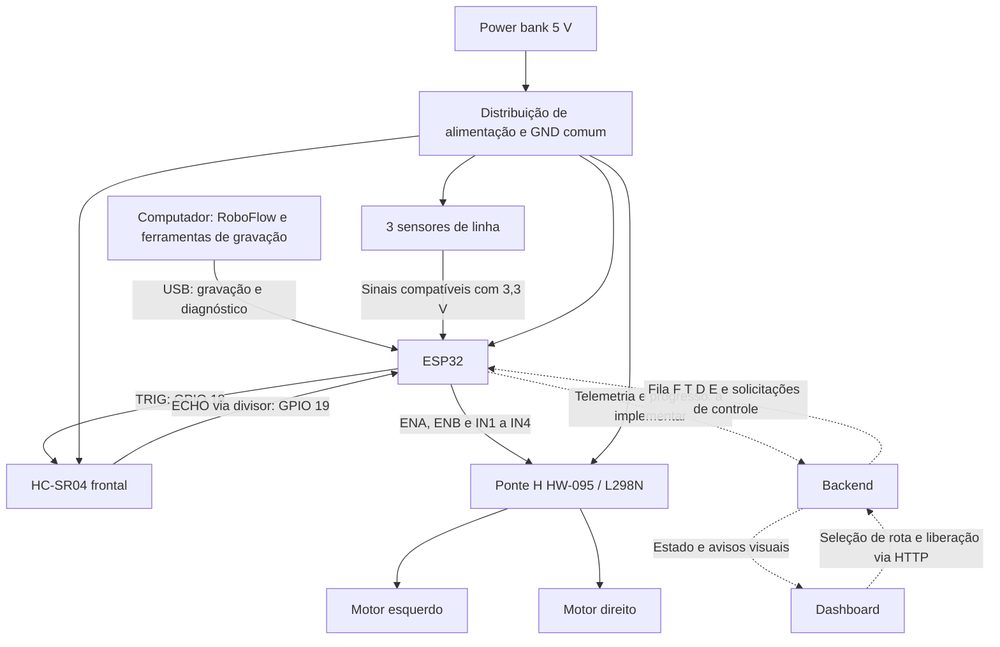

# Arquitetura dos componentes do robô — RoboFlow

Atualizado em 21/10/2026. Documento técnico de referência para montagem e implementação. A descrição funcional está em [O que o robô faz](O_QUE_O_ROBO_FAZ.md).

## 1. Escopo e premissas

A configuração adota uma placa de desenvolvimento com **ESP32 clássico da família ESP32-WROOM-32**, ponte H **HW-095 com L298N**, dois motores DC com redutor, três sensores de linha, HC-SR04 frontal e power bank com saída regulada de 5 V.

Esta pinagem não deve ser transferida automaticamente para ESP32-C3, S2 ou S3. Conferir os GPIOs expostos na placa. A marcação HW-095, isoladamente, não comprova o circuito: confirmar o CI L298N, os bornes e o jumper do regulador. Motores, sensores de linha, corrente do power bank e variante da placa não foram identificados por modelo; as verificações correspondentes estão indicadas abaixo.

## 2. Visão integrada



O computador compila RoboFlow para um sketch completo, copiado e gravado manualmente pela Arduino IDE. Na operação, a dashboard seleciona a rota, o backend converte seus pontos em fila F/T/D/E e o ESP32 executa com sensores e controle local. O backend recebe telemetria; a autorização final de movimento continua no supervisor do ESP32. Ver [plano do backend](PLANO_BACKEND_ROBOFLOW.md).

## 3. Componentes e responsabilidades

| Componente | Quantidade | Responsabilidade e interface |
|---|---:|---|
| ESP32 de desenvolvimento | 1 | Leitura dos sensores, decisão de movimento, PWM, veto de movimento e serial USB |
| HW-095 / L298N | 1 | Dois canais de potência; recebe seis sinais do ESP32 e alimenta os motores |
| Motor DC com redutor | 2 | Tração diferencial; tensão e corrente de partida a confirmar |
| Sensores de linha | 3 canais | Identificar contraste sob o chassi; saída digital ou analógica a confirmar |
| HC-SR04 | 1 | Medição frontal; alimentação de 5 V, TRIG e ECHO |
| Resistores de 10 kΩ e 15 kΩ, preferencialmente 1% | 1 de cada | Divisor do ECHO de 5 V para aproximadamente 3 V |
| Resistores de 10 kΩ | 2 adicionais | Pull-down em ENA e ENB para manter motores desabilitados no reset |
| Power bank e cabos de alimentação | 1 conjunto | Fornecer 5 V com capacidade para os picos de partida |
| Chassi, rodas e apoio livre | 1 conjunto | Sustentação e mobilidade |
| Chave de alimentação e proteção de corrente | Conforme dimensionamento | Desligamento acessível e proteção da distribuição |

O chassi pode ter mais de duas rodas, mas este mapa pressupõe dois canais de tração. Se houver motores em paralelo por canal, somar suas correntes, incluindo partida e travamento. Encoders, buzzer, LEDs externos, RFID e câmera não fazem parte do conjunto confirmado.

## 4. Pinagem consolidada

Os números são **GPIOs**, não posições físicas no conector.

| Sinal do módulo | GPIO ESP32 | Direção no ESP32 | Observação |
|---|---:|---|---|
| HW-095 ENA | 25 | Saída PWM | Velocidade do canal A, motor esquerdo |
| HW-095 IN1 | 26 | Saída digital | Direção do canal A |
| HW-095 IN2 | 27 | Saída digital | Direção do canal A |
| HW-095 IN3 | 14 | Saída digital | Direção do canal B |
| HW-095 IN4 | **23** | Saída digital | Substitui o GPIO 12 |
| HW-095 ENB | 13 | Saída PWM | Velocidade do canal B, motor direito |
| Sensor de linha esquerdo | 32 | Entrada | Nível máximo compatível com 3,3 V |
| Sensor de linha central | 34 | Entrada | Sem pull-up/pull-down interno |
| Sensor de linha direito | 33 | Entrada | Nível máximo compatível com 3,3 V |
| HC-SR04 TRIG | **18** | Saída digital | Pulso de disparo |
| HC-SR04 ECHO | **19** | Entrada digital | **Obrigatoriamente por divisor ou conversor de nível** |

Os GPIOs 18 e 19 estão livres nesta configuração, suportam as direções necessárias e não são pinos de seleção de boot do ESP32 clássico. Suas funções alternativas de SPI não impedem esse uso, mas futuras expansões terão de respeitar a reserva. Os GPIOs 13 e 14 ficam comprometidos para uso simultâneo de JTAG.

O GPIO 12 deixa de ser usado: no ESP32 clássico, seu nível durante o reset pode alterar a configuração da tensão da memória flash. Os GPIOs 0, 2, 5, 12 e 15 têm funções de configuração de boot. GPIOs 6 a 11 normalmente atendem à flash; GPIOs 1 e 3 ficam reservados aqui para gravação e diagnóstico. GPIO34 é somente entrada e não possui resistores internos de polarização. Referência: [documentação GPIO da Espressif](https://docs.espressif.com/projects/esp-idf/en/v5.5.6/esp32/api-reference/peripherals/gpio.html).

## 5. Alimentação e terra comum

### 5.1 Distribuição de 5 V

Para o módulo L298N convencional **confirmado** e com alimentação dos motores em 5 V:

```text
Power bank +5 V
    +---> VS / VIN / borne marcado 12V da HW-095 (alimentação dos motores)
    +---> borne +5V lógico da HW-095 (jumper 5V-EN REMOVIDO)
    +---> VCC do HC-SR04
    +---> alimentação da placa ESP32 por USB OU entrada 5V aprovada pela placa
    +---> sensores de linha: somente se o modelo aceitar 5 V,
          com suas saídas adequadas ao ESP32

Power bank GND
    +---> GND da HW-095
    +---> GND do ESP32
    +---> GND do HC-SR04
    +---> GND dos sensores de linha
    +---> parte inferior do divisor de tensão do ECHO
```

Se os sensores aceitarem 3,3 V, podem usar uma alimentação regulada nessa tensão, com orçamento de corrente verificado. O diagrama não autoriza colocar 5 V em sensores exclusivos de 3,3 V.

**Não unir VS e +5V sem antes confirmar o circuito e retirar o jumper do regulador.** No módulo L298N comum, o jumper **5V-EN** conecta o regulador interno à alimentação lógica. Com ele retirado, o borne lógico recebe 5 V externos. A alimentação de 5 V na entrada do regulador não produz uma saída lógica regulada de 5 V. Se a placa diferir desse circuito, seguir seu esquema específico antes de ligar.

O rótulo `12V` identifica o borne de potência, não exige aplicar 12 V no arranjo descrito. Nunca aplicar 12 V ao borne lógico de 5 V, ao HC-SR04 ou a um GPIO.

### 5.2 Cuidados de distribuição

O negativo da alimentação, GND da ponte H e GND do ESP32 precisam estar conectados. No módulo comum de três bornes, GND costuma ser o central; **confirmar pela inscrição da placa**, sem deduzir pela orientação de uma foto.

Distribuir os ramos de potência e lógica a partir da fonte. Não conduzir a corrente dos motores pelo regulador do ESP32, por seus GPIOs ou por trilhas de protoboard inadequadas. Usar cabos e proteção compatíveis com a corrente medida. Capacitores próximos da ponte H e dos sensores ajudam a reduzir ruído; dimensionar após observar os transientes e respeitar polaridade e tensão.

Não conectar simultaneamente duas fontes de 5 V à placa ESP32 sem confirmar isolamento no esquema da placa. Na gravação, usar o USB do computador e manter o ramo positivo alternativo do ESP32 desligado; a ponte H deve permanecer desabilitada. Não usar cabo em Y que una a saída do computador à do power bank. A escolha entre USB e pino 5V/VIN depende da placa: o ESP32 em si opera em 3,3 V.

### 5.3 Limitações do conjunto power bank + L298N

O L298N tem queda interna significativa: com entrada de 5 V, o motor recebe menos que isso sob carga. Se o carrinho não arrancar, verificar a tensão nos motores, queda nos cabos, consumo e tensão nominal dos motores. PWM alto não recupera a tensão perdida.

Não presumir que qualquer motor de 12 V funcionará adequadamente com esse arranjo. A capacidade de corrente deve incluir as partidas simultâneas dos motores e a eletrônica; o limite anunciado do CI não garante a mesma corrente contínua no módulo montado. Validar aquecimento e desligamento automático do power bank em baixa carga. Referência elétrica: [datasheet L298 da STMicroelectronics](https://www.st.com/resource/en/datasheet/cd00000240.pdf).

## 6. Ligações da ponte H e motores

```text
ESP32 GPIO25 ---> ENA         OUT1 / OUT2 ---> motor esquerdo
ESP32 GPIO26 ---> IN1
ESP32 GPIO27 ---> IN2

ESP32 GPIO14 ---> IN3         OUT3 / OUT4 ---> motor direito
ESP32 GPIO23 ---> IN4
ESP32 GPIO13 ---> ENB
ESP32 GND   ---> GND
```

Remover os jumpers de **ENA e ENB** antes de controlar essas entradas por PWM. Eles são diferentes do jumper **5V-EN** do regulador. Instalar um resistor de 10 kΩ entre ENA e GND e outro entre ENB e GND para que o reset não deixe os canais habilitados.

| Enable | INx1 | INx2 | Resultado por canal |
|---|---|---|---|
| LOW | Qualquer | Qualquer | Saídas desabilitadas; roda desacelera por inércia |
| HIGH/PWM | HIGH | LOW | Giro em um sentido |
| HIGH/PWM | LOW | HIGH | Giro no sentido oposto |
| HIGH | LOW | LOW | Frenagem elétrica, conforme circuito e carga |
| HIGH | HIGH | HIGH | Frenagem elétrica, conforme circuito e carga |

O sentido físico depende da polaridade e da montagem espelhada dos motores. Para a primeira integração, adotar parada por ENA/ENB em LOW. Frenagem ativa e inversão de sentido exigem validar corrente e comportamento do conjunto. Não inverter abruptamente sob carga.

## 7. Sensores de linha

Montar os sensores esquerdo, central e direito alinhados transversalmente, sob a frente do chassi, voltados para o piso. Ajustar altura e espaçamento à largura da fita e ao módulo usado; iniciar conforme a especificação do fabricante e calibrar na pista real.

```text
Saída esquerda ---> GPIO32
Saída central  ---> GPIO34
Saída direita  ---> GPIO33
GND de todos   ---> GND comum
```

Identificar se as saídas são digitais `DO` ou analógicas `AO`. Em módulos digitais, ajustar os comparadores e registrar qual nível indica a linha. Em módulos analógicos, calibrar limiares por sensor. Os três GPIOs escolhidos também pertencem ao ADC1 no ESP32 clássico.

**As entradas do ESP32 não devem receber 5 V.** Preferir alimentar o sensor em 3,3 V quando seu fabricante permitir. Se o sensor exigir 5 V, verificar sua saída: push-pull de 5 V exige adaptação; coletor aberto pode usar pull-up externo a 3,3 V somente se não houver pull-up de 5 V ainda conectado à mesma saída. GPIO34 exige polarização externa quando a saída não dirige ambos os níveis. Medir o nível alto antes de conectar.

Convenção lógica no firmware: `1 = linha detectada`, depois de normalizar a polaridade elétrica. Usar a ordem `(esquerdo, central, direito)`:

| Leitura normalizada | Decisão inicial |
|---|---|
| 010 | Seguir em frente |
| 100 ou 110 | Corrigir para a esquerda |
| 001 ou 011 | Corrigir para a direita |
| 000 | Parar por perda da linha |
| 101 ou 111 | Parar por ambiguidade até haver regra de cruzamento validada |

Começar com controle proporcional ou regras discretas. Um PID pode ser integrado depois da calibração, mas três sensores digitais não fornecem a mesma resolução de um array analógico maior. Sem encoders, o PWM representa esforço de acionamento, não velocidade medida em m/s.

### 7.1 Grade e cruzamentos

A pista definida é uma grade de linhas e colunas. Cada cruzamento corresponde a um ponto lógico `(x,y)` e cada ação percorre um único segmento até o próximo cruzamento. F mantém o rumo; D/E viram no cruzamento atual e avançam ao seguinte; T desloca em ré mantendo a orientação, sujeito à validação específica e capacidade habilitada. O protótipo começa em cruzamento e orientação conhecidos.

O firmware deve implementar fases de manobra/alinhamento, saída do cruzamento atual, seguimento e confirmação da chegada seguinte. Rearmar a detecção somente depois de sair da região anterior e filtrar as leituras evita contar o mesmo cruzamento várias vezes. Calibrar largura da fita, espaçamento, posição dos sensores em relação ao eixo das rodas e critério de chegada. Não assumir que uma leitura isolada 101/111 prova chegada: sem regra validada, continua sendo ambiguidade e implica parada.

Não há sensor de posição absoluta ou leitura de velocidade. O backend acompanha a posição pela origem/orientação e pelos índices concluídos. Perda de referência exige parada e reposicionamento confirmado. A marcha à ré ainda não foi validada e o ultrassom frontal não cobre obstáculos atrás; o plano do backend propõe mantê-la desabilitada no MVP.

## 8. HC-SR04 frontal: montagem e ligações

### 8.1 Quatro conexões

Conferir os nomes impressos no módulo, pois a orientação física pode variar.

| Pino HC-SR04 | Ligação |
|---|---|
| VCC | 5 V regulados do power bank |
| TRIG | GPIO18 do ESP32 |
| ECHO | Resistor de 10 kΩ, depois nó de leitura ligado ao GPIO19 |
| GND | GND comum |

No nó de leitura instalar também um resistor de 15 kΩ até GND:

```text
HC-SR04 ECHO (aprox. 5 V)
          |
       R1 = 10 kΩ
          |
          +----------------> ESP32 GPIO19
          |
       R2 = 15 kΩ
          |
         GND --------------> ESP32 GND e HC-SR04 GND

ESP32 GPIO18 --------------> HC-SR04 TRIG
5 V ----------------------> HC-SR04 VCC
```

O divisor resulta em `Ventrada = Vecho × 15 / (10 + 15)`: aproximadamente **3,0 V** para ECHO de 5 V. Esse valor fornece margem em relação a 3,3 V. Não inverter os resistores, não omitir o resistor até GND e não conectar ECHO diretamente ao ESP32. A necessidade de adaptação decorre da saída de 5 V do módulo e dos limites elétricos do ESP32; conferir com [o fornecedor RoboCore](https://www.robocore.net/sensor-robo/sensor-de-distancia-ultrassonico-hc-sr04) e [o datasheet do ESP32](https://documentation.espressif.com/esp32_datasheet_en.html).

O TRIG de 3,3 V é utilizável nas variantes com entrada TTL compatível. Confirmar no módulo adquirido; se ele exigir um nível alto maior, usar conversor unidirecional apropriado de 3,3 V para 5 V no TRIG. Não elevar a saída do ESP32 com pull-up a 5 V.

### 8.2 Posição física

Fixar o HC-SR04 na frente, centralizado, com os transdutores voltados para a frente e sem obstáculos do próprio chassi. Ajustar a altura para detectar os objetos de interesse sem medir o piso. Se o sensor estiver atrás da extremidade frontal, descontar esse recuo da distância livre efetiva. Fixação firme evita mudanças de direção do feixe durante a marcha.

### 8.3 Aquisição e tratamento

1. Manter TRIG em LOW em repouso.
2. Emitir pulso HIGH de aproximadamente 12 µs.
3. Medir quanto tempo ECHO permanece HIGH, com timeout limitado.
4. Calcular `distancia_cm ≈ tempo_echo_us / 58`.
5. Aguardar pelo menos 60 ms entre disparos; adotar inicialmente **70 ms**.

Usar inicialmente timeout de **25 ms**, sujeito à validação do módulo. Timeout, pulso fora da faixa útil e ausência de atualização significam **medição inválida**, nunca caminho livre. Ausência de eco também pode ocorrer em espaço aberto; a política conservadora pode parar o robô nessa condição. Para ampliar a disponibilidade, validar outro tratamento ou outro sensor antes de relaxar o bloqueio.

O intervalo mínimo e a temporização estão descritos no [manual HC-SR04](https://www.arobose.com/docs/HC-SR04/HC-SR04_Manual.pdf). A faixa nominal comum é de aproximadamente 2 cm a 4 m; não equivale a alcance garantido para qualquer alvo. A fórmula também aparece na [documentação do módulo SunFounder](https://docs.sunfounder.com/projects/picar-x-v20/en/latest/hardware/cpn_ultrasonic.html).

Preferir captura de bordas por interrupção/periférico e máquina de estados sem bloqueio. `pulseIn` com timeout pode servir ao teste isolado, mas bloqueia o fluxo por até o timeout e precisa ser considerado no orçamento de reação. Não prometer veto em 20 ms com medições a cada 70 ms.

## 9. Firmware e prioridade de movimento

O firmware-base deverá conter drivers de motores, sensores de linha, ultrassom, temporização, supervisor, executor de comportamento e diagnóstico serial. Não há firmware correspondente versionado neste repositório nesta revisão.

### 9.1 Estados propostos

| Estado | Saída dos motores | Saída do estado |
|---|---|---|
| INICIALIZANDO | Desabilitados | Leituras válidas, autoteste e liberação |
| PRONTO | Desabilitados | Comando explícito de início com condições válidas |
| SEGUINDO_LINHA | Controle diferencial | Obstáculo, perda de linha, parada ou evento de estação |
| PARADO_OBSTACULO | Desabilitados | Três leituras ≥25 cm, linha válida e liberação explícita |
| LINHA_PERDIDA | Desabilitados | Reposicionamento, linha válida e liberação |
| FALHA_SENSOR | Desabilitados | Diagnóstico resolvido, medições válidas e liberação |
| AGUARDANDO_ESTACAO | Desabilitados | Evento autorizado e condições válidas |
| FINALIZADO | Desabilitados | Nova missão liberada |

No início ou reset, configurar os enables em LOW antes de habilitar qualquer saída de potência. O supervisor deve continuar lendo o ultrassom em todos os estados. Esperas de missão não podem suspender sensores.

### 9.2 Regra de autorização

Toda solicitação de velocidade deve passar por uma única função de saída. Ela desabilita ENA e ENB se houver distância ≤20 cm, leitura inválida, leitura com idade superior a **200 ms**, linha perdida, falha ou parada solicitada. O limiar de idade é inicial e deve ser validado com a temporização real. Filtros não podem atrasar a primeira parada por uma leitura próxima; usar as três leituras consecutivas apenas para liberar o bloqueio.

O controle da linha pode começar com atualização a cada 10 ms e o ultrassom a cada 70 ms, com execução sem bloqueio. Uma estimativa de margem de parada é:

```text
distancia_limite >= velocidade_maxima × latencia_total
                   + distancia_de_desaceleracao_medida + margem
```

A latência inclui fase entre medições, aquisição e agendamento. Medir a distância real com carga, piso e bateria representativos. Desabilitar motores em software é um veto de firmware, não um circuito de emergência independente: uma falha do ESP32 pode comprometer o controle. Manter desligamento físico acessível para os ensaios.

## 10. Compilador RoboFlow

### 10.1 O que existe

| Arquivo | Responsabilidade |
|---|---|
| `compiler/roboflow/tokens.py` | Tipos de token e palavras reservadas |
| `compiler/roboflow/lexer.py` | Tokenização, posição de origem e erros léxicos |
| `compiler/roboflow/parser.py` | Reconhecimento sintático e erros com linha/coluna |
| `compiler/roboflow/ast_nodes.py` | Nós da árvore sintática |
| `examples/demo_compilador.py` | Demonstração de tokens e AST |
| `examples/rota_basica.rf`, `examples/rota_completa.rf` | Programas de exemplo |

Tokens: palavras reservadas, identificadores, strings, números, durações, `==`, chaves, parênteses, dois-pontos, vírgula e EOF. Espaços e comentários são descartados pelo lexer. A duração é representada em segundos na AST.

Resumo da sintaxe reconhecida pelo parser, não uma validação semântica:

```text
programa   := estacao*
estacao    := "station" (STRING | "default") "{" "on_arrival" "{" comando* "}" "}"
comando    := chamada | condicional
chamada    := KEYWORD "(" [argumento ("," argumento)*] ")"
argumento  := STRING | NUMBER | DURATION | ID | "timeout" ":" (DURATION | "none")
condicional := "if" ID "==" (STRING | ID) "{" comando* "}"
               ["else" "{" comando* "}"]
```

O catálogo inclui `stop`, `set_speed`, `turn_left`, `turn_right`, `continue_straight`, `resume_line_following`, `signal_buzzer`, `signal_light`, `log` e `wait_signal`. O parser usa palavras reservadas para chamadas; verificar nome permitido, argumentos, tipos, unidades, duplicidade de estações e disponibilidade de hardware será responsabilidade semântica. Reconhecer `signal_buzzer()` não significa que exista um buzzer instalado.

Para reproduzir a demonstração, a partir da raiz do projeto:

```powershell
python examples/demo_compilador.py examples/rota_basica.rf
python examples/demo_compilador.py examples/rota_completa.rf
```

### 10.2 Arquitetura de geração a implementar

```text
arquivo .rf -> lexer -> parser -> AST
            -> análise semântica -> representação intermediária
            -> comportamento C++ gerado + firmware-base
            -> compilação Arduino/PlatformIO -> gravação no ESP32
```

O alvo escolhido é o ESP32. O compilador roda no computador e deverá compor a lógica RoboFlow e os templates de drivers, aquisição, inicialização, comunicação, executor e veto em um único sketch `.ino` completo para copiar e colar na Arduino IDE. O usuário compila e grava manualmente. Análise semântica, representação intermediária, geração e runtime ainda não estão presentes. A rota selecionada chega do backend durante a operação e não exige regravar a placa.

O runtime deverá executar esperas por estados e relógios, sem `delay` longo. `wait_signal` com timeout deve terminar em parada e diagnóstico quando vencer; `timeout: none` mantém a espera, preservando o supervisor. Velocidade física em m/s exige calibração ou encoders; não mapear arbitrariamente um valor da DSL para uma velocidade comprovada.

Os eventos de avanço serão confirmações de cruzamentos da grade pelo executor. O backend associa o progresso da fila a coordenadas e estações cadastradas; o sensor não identifica nomes. Durante o desenvolvimento, eventos podem ser injetados pela serial como simulação. O HC-SR04 informa distância, não presença de carga ou nome de estação.

## 11. Comunicação e dashboard

USB serial será a interface inicial para gravação, diagnóstico e futura coleta de telemetria. Adotar 115200 baud, 8N1 no firmware e no monitor; isso não fixa a velocidade usada pelo esptool para upload. As mensagens abaixo são uma proposta a implementar, não um protocolo existente:

```text
STATE SEGUINDO_LINHA
LINE 0 1 0
DIST 31.5 VALID
STOP OBSTACLE
FAULT ULTRASONIC_TIMEOUT
```

Registrar tempo monotônico, estado, leituras e motivo de parada. Nenhum comando serial pode remover o veto. Se o futuro modo depender de comandos remotos contínuos, definir timeout da comunicação e parada por perda de conexão antes de ativá-lo.

O frontend em `dashboard/` usa React, TypeScript e Vite. `src/services/api.ts` centraliza HTTP, com URL definida por `VITE_API_URL` ou `/api`. Os serviços consultam missões, logs, alertas e métricas. `src/main.tsx` ativa a simulação quando `VITE_DEMO=true`. A ponte ESP32 → backend precisa ser implementada; a interface não lê GPIOs nem serial diretamente. Os contratos específicos permanecem nos arquivos do próprio dashboard.

## 12. Gravação do ESP32 e problemas de boot

1. Desligar a alimentação dos motores e deixar as rodas suspensas. Para diagnosticar upload, desconectar os periféricos e manter somente computador → USB → ESP32.
2. Na Arduino IDE, selecionar a placa correspondente ao modelo real, com método de gravação `esptool`.
3. Desconectar o USB e observar as portas em **Ferramentas → Porta**; reconectar e selecionar a COM que surgiu. Não presumir COM1 nem fixar um número nesta documentação.
4. Usar cabo USB de dados e fechar programas que estejam ocupando a serial.
5. Tentar o upload. Se ficar em `Connecting...`, manter **BOOT** pressionado durante a conexão e soltar quando iniciar `Writing at...`.
6. Se necessário, com BOOT pressionado, apertar e soltar **EN/RESET** e repetir a tentativa. Ao concluir, soltar BOOT e reiniciar normalmente.
7. Com a alimentação desligada, reconectar os periféricos conforme o novo mapa, especialmente **IN4 → GPIO23**.

GPIO12 ligado à ponte H é uma causa possível de problema de boot, não um diagnóstico confirmado de toda falha de comunicação. Persistindo a falha com a placa isolada, verificar driver USB-serial, cabo, porta, placa selecionada e alimentação.

## 13. Montagem e validação de bancada

| Etapa | Verificação e critério |
|---|---|
| Inspeção desligada | Confirmar CI, bornes, GPIOs, ausência de curtos, divisores e posição dos três jumpers |
| Alimentação sem motores | Medir 5 V e 3,3 V nos pontos corretos e conferir GND comum |
| Níveis de sinal | Medir saídas dos sensores; conferir ECHO reduzido no nó do GPIO19 |
| Boot e reset | Canais A/B permanecem desabilitados, sem pulso de movimento |
| Motor individual | Com rodas suspensas, testar cada canal com PWM baixo e confirmar esquerda/direita e sentido |
| Sensores de linha | Registrar níveis sobre linha e piso e validar a tabela normalizada |
| Ultrassom isolado | Comparar com régua, por exemplo em 10, 20, 25 e 50 cm, usando alvo plano; confirmar timeout |
| Prioridade do veto | Solicitar movimento e aproximar alvo; ambos os canais devem desabilitar independentemente da missão |
| Falhas | Desconectar sensor com alimentação desligada e religar; ausência de eco não pode liberar movimento |
| Recuperação | Retirar alvo; carrinho permanece parado até leituras de liberação e comando explícito |
| Pista em baixa velocidade | Validar correções, perda de linha, cruzamentos e distância real de parada |
| Carga e autonomia | Verificar partida simultânea, aquecimento, reset por queda de tensão e corte do power bank |

Resultados físicos ainda precisam ser obtidos. Registrar configuração, PWM, carga, distância de parada e falhas observadas antes de aumentar a velocidade. Conferir o firmware com as rodas suspensas após qualquer alteração de pinagem.

## 14. Decisões pendentes

Para fechar a implementação, identificar a variante da placa ESP32, esquema da HW-095, tensão/corrente dos motores, modelo e tipo de saída dos sensores de linha e capacidade real do power bank. Depois implementar firmware, validar os limites de parada, definir identificação de estações e sinais externos, completar o compilador e integrar telemetria.

Esta revisão substitui as arquiteturas anteriores da pasta `docs`: a configuração de referência usa ESP32, tração diferencial, três sensores de linha e HC-SR04, com o comportamento compilado destinado ao próprio ESP32.
