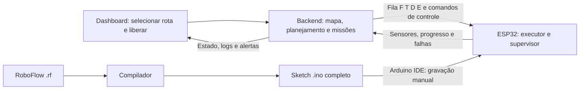

# Plano do backend RoboFlow

Atualizado em 21/10/2026. Plano de implementação, sem backend implementado nesta entrega.

> **Aviso (26/10/2026):** a arquitetura de nuvem — **Cloud Run, poll HTTPS do ESP32, Firestore, Pub/Sub** — **supera** as passagens deste plano sobre serial USB, backend no computador, heartbeat/parada de 250 ms / 1.000 ms e "linguagem/banco não escolhidos". Elas seguem abaixo marcadas como **SUPERADAS**. Convenção de coordenadas: **y para baixo** (§4–§5 atualizadas). Decisões em [docs/adr/0001 a 0005](adr) e [0008](adr/0008-um-start-resume-pendente-por-vez.md); modelo de dados em [FIRESTORE_MODEL.md](FIRESTORE_MODEL.md).

A especificação técnica para a futura implementação está em [backend/README.md](../backend/README.md), com modelos, estados, contratos HTTP, protocolo do dispositivo e critérios de validação. Este plano mantém a visão das etapas e decisões do projeto.

## 1. Objetivo e fontes

O usuário seleciona uma rota na dashboard. O backend resolve essa rota em pontos `(x,y)`, traduz os deslocamentos para uma fila de comandos `F`, `T`, `D`, `E`, envia ao ESP32 e acompanha a execução pela telemetria. O ESP32 lê sensores, executa ações e mantém o veto local de movimento. Não há medição de velocidade nem requisito de encoders.

Fontes consideradas:

- [Arquitetura dos componentes](ARQUITETURA_DOS_COMPONENTES.md): montagem, pinagem e supervisor local.
- [O que o robô faz](O_QUE_O_ROBO_FAZ.md): funcionamento físico e limitações.
- [Contrato HTTP existente](../dashboard/BACKEND_INTEGRATION.md), `dashboard/src/types/index.ts` e serviços HTTP: compatibilidade com a interface atual.
- [README da dashboard](../dashboard/README.md): execução e publicação.
- [Documentação do compilador](../compiler/DOCUMENTACAO_COMPILADOR_ROBOFLOW.md): implementação atual e sketch a gerar.
- README da raiz, pitch e plano de produto: contexto histórico e acadêmico. As propostas antigas de Raspberry Pi, geração automática de binário e gramática `route/point` não definem a implementação atual.

As decisões desta conversa atualizam a divisão de responsabilidades dos documentos anteriores. Os dois documentos físicos continuam sendo a referência de montagem; suas passagens sobre missão totalmente local devem ser lidas com a divisão abaixo.

## 2. Decisões e propostas

| Item | Situação |
|---|---|
| Seleção da rota no frontend | Definida pelo usuário; tela ainda a implementar |
| Planejamento e processamento pesado no backend | Definidos |
| Coordenadas convertidas em fila F/T/D/E | Definido |
| F = frente; T = trás; D = direita; E = esquerda | Confirmado na conversa |
| Sensores e execução dos motores no ESP32 | Definidos |
| Sem leitura de velocidade | Definido; PWM é nível de acionamento |
| Avisos visuais na dashboard | Definidos; buzzer/LED externos não são exigidos |
| Parar por obstáculo, leitura inválida/vencida ou perda de linha | Definido |
| Retomada explícita, condicionada pelo ESP32 | Política definida na conversa |
| Sketch completo copiado para Arduino IDE | Saída definida para o compilador |
| ~~USB serial inicialmente; Wi-Fi posteriormente~~ | **SUPERADA** (ADR 0001): poll HTTPS ao Cloud Run |
| ~~Parada por perda de comunicação~~ | **SUPERADA** (ADR 0002): fila local, vetos locais, sem nuvem segura no próximo cruzamento |
| Pista em grade de linhas e colunas; cruzamentos são pontos `(x,y)` | Definido pelo usuário |
| Cada comando termina no próximo cruzamento | Definido pelo usuário |
| Reconhecimento dos cruzamentos pelos três sensores | Implementação e validação física pendentes |

## 3. Responsabilidades



| Camada | Responsabilidade |
|---|---|
| Frontend | Escolher rota cadastrada, visualizar prévia, iniciar, parar, solicitar retomada e exibir avisos |
| Backend | Validar mapa/rota, traduzir coordenadas, gerenciar missão, persistir eventos e fornecer a API |
| ESP32 | Ler linha e ultrassom, corrigir trajetória localmente, executar a fila, confirmar progresso e vetar movimento |
| Compilador | Traduzir RoboFlow em sketch completo contendo o executor e o suporte embarcado |

O backend não deve receber cada leitura para decidir cada pulso de motor. Correções rápidas de linha, temporização e parada continuam locais. Ele decide o percurso e acompanha sua execução, sem depender de latência de rede para evitar movimento indevido.

A escolha de uma rota não exige recompilar nem gravar o ESP32: o firmware recebe uma nova fila. O compilador roda antes da operação, quando se altera o programa embarcado.

## 4. Mapa, coordenadas e orientação

A pista será uma grade de linhas e colunas desenhada no chão. Cada cruzamento representa um ponto `(x,y)`. O backend cadastra essa grade como grafo ortogonal dirigido: cada nó é um cruzamento e cada aresta liga cruzamentos vizinhos consecutivos, declarando os sentidos permitidos. Coordenadas são índices lógicos de coluna e linha, não posições medidas pelo carrinho nem metros percorridos.

Usar um incremento de coordenada por cruzamento. Uma sequência `(0,0) → (0,2)` precisa incluir `(0,1)` se esse cruzamento existir na pista: o executor não pode ignorá-lo. Espaçamento físico, largura das linhas, tamanho da grade e eventuais conexões ausentes ainda precisam ser definidos e calibrados.

Uma rota cadastrada armazena a sequência de IDs de nós, versão do mapa e orientação inicial. O backend obtém os pontos do mapa, sem confiar em coordenadas arbitrárias enviadas pelo navegador.

Convenção adotada ([ADR 0004](adr/0004-eixo-de-coordenadas.md)): origem `(0,0)` no canto superior esquerdo, `x` aumenta para a direita (leste) e `y` aumenta para **baixo** (sul). Orientações `N=(0,-1)`, `E=(+1,0)`, `S=(0,+1)`, `W=(-1,0)`. Não confundir orientação `E` (east/leste) com comando `E` (esquerda).

```json
{
  "id": "rota-carga",
  "mapId": "pista-1",
  "mapVersion": 1,
  "initialHeading": "N",
  "nodeIds": ["A", "B", "C", "D"],
  "points": [{"x":0,"y":3},{"x":0,"y":2},{"x":1,"y":2},{"x":1,"y":1}]
}
```

O ponto e a orientação iniciais devem ser confirmados pelo operador após posicionar o carrinho. O hardware atual não determina sua posição absoluta nem identifica nomes de estações. Posição mostrada na dashboard será **estimada por progresso confirmado**, não GPS ou localização contínua.

Validar antes de enviar: nós existentes, arestas conectadas entre vizinhos, orientação inicial, versão do mapa, ausência de pontos consecutivos iguais, geometria suportada e capacidades do firmware. Rejeitar diagonais e saltos sobre cruzamentos intermediários. Para coordenadas inteiras da grade, cada trecho deve satisfazer `abs(dx) + abs(dy) = 1`, além de existir como conexão física cadastrada.

## 5. Tradução para F/T/D/E

Regra definida: **cada comando representa ir do cruzamento atual até o próximo cruzamento**. O carrinho começa sobre um cruzamento, em posição e orientação conhecidas. `D` e `E` incluem virar no cruzamento atual e avançar até o seguinte; não emitir um `F` adicional para o mesmo segmento. `T` significa marcha à ré até o próximo cruzamento atrás do chassi, mantendo sua orientação; não significa girar 180 graus e não exige que esse cruzamento já tenha sido visitado.

| Comando | Ação e término |
|---|---|
| `F` | Seguir em frente até o próximo cruzamento |
| `D` | Virar à direita no cruzamento atual e seguir até o próximo |
| `E` | Virar à esquerda no cruzamento atual e seguir até o próximo |
| `T` | Ir de ré até o próximo cruzamento atrás, mantendo a orientação; execução física ainda restrita |

Chegada a um cruzamento é uma fronteira lógica entre ações, não exige parada em todos eles. Pode haver continuação após confirmação se a próxima ação e o supervisor permitirem. Ao concluir o último item, desabilitar os motores e confirmar o fim da missão.

Para cada aresta, calcular o rumo desejado a partir de `dx`/`dy`, comparar com a orientação atual e aplicar:

| Rumo relativo | Comando | Orientação após ação |
|---|---|---|
| Mesmo rumo | `F` | Mantida |
| 90° à direita | `D` | Rumo da aresta |
| 90° à esquerda | `E` | Rumo da aresta |
| Oposto | `T` | Mantida, pois desloca em ré |

Com os pontos do exemplo e orientação `N`, a fila é `["F","D","E"]`. Uma aresta de `(0,3)` para `(0,4)` (para baixo, sul), com orientação `N`, produz `T` se a ré for permitida naquela aresta e suportada pelo robô.

| Índice | Origem → destino | Rumo antes → depois | Comando |
|---|---|---|---|
| 0 | `(0,3) → (0,2)` | N → N | F |
| 1 | `(0,2) → (1,2)` | N → E (leste) | D |
| 2 | `(1,2) → (1,1)` | E (leste) → N | E (esquerda) |

A origem não conta como uma ação concluída. São quatro cruzamentos na rota e três comandos; cada confirmação atualiza um único destino. A última chegada encerra a fila e solicita a parada local.

Essa convenção deve ser compartilhada com o executor. Não confundir comando recebido, aceito, iniciado e concluído.

### 5.1 Como terminar uma ação

Sem encoders, o avanço será confirmado pela detecção do **próximo cruzamento da grade**, e não por distância ou velocidade medidas. Os três sensores precisam de uma regra de reconhecimento calibrada na pista. Um padrão `111` ou `101` é apenas candidato: não identifica coordenada nem garante cruzamento válido por si só.

Fases do executor, a implementar:

1. No cruzamento atual, escolher a ação pelo índice da fila.
2. Para D/E, executar a curva e alinhar com a linha de saída; para F, manter o rumo. T mantém o rumo do chassi, quando habilitado.
3. Confirmar que saiu da região do cruzamento atual antes de armar a próxima detecção.
4. Seguir o segmento com correção de linha e supervisor ativos.
5. Confirmar uma nova entrada em cruzamento com filtragem estável, sem contar o mesmo cruzamento várias vezes.
6. Emitir `action_completed` com índice único; só então avançar a fila e atualizar a posição lógica no backend.

A posição física dos sensores em relação ao eixo das rodas exige calibrar a referência de chegada/alinhamento para que a próxima curva seja executável. Detectar a faixa transversal não significa que o centro do chassi já esteja no centro do cruzamento. A manobra deve declarar fases nas quais ausência momentânea de linha é esperada e limitada; fora delas, ausência é falha. Uma ação nunca termina só porque o backend a enviou.

Os cruzamentos podem ser visualmente iguais. O backend atualiza a posição pela origem/orientação conhecidas e pela sequência confirmada; não recebe coordenadas medidas pelo ESP32. Se houver cruzamento perdido, contagem inconsistente ou perda de referência, parar, indicar posição incerta e exigir reposicionamento confirmado antes de executar uma nova sequência.

Timeout de ação limita espera e gera parada/falha; não deve ser usado como comprovação de distância ou conclusão. Calibração temporal de curvas pode auxiliar ensaios, mas exige confirmação de linha.

### 5.2 Limite da marcha à ré

`T` faz parte do protocolo, mas sua execução física fica bloqueada no MVP (`supportsReverse=false`). O único HC-SR04 está na frente e os sensores de linha também ficam à frente do chassi. Não existe cobertura traseira confirmada nem seguimento em ré validado. Rotas que produzam `T` devem retornar erro de capacidade antes da partida; não substituir silenciosamente por meia-volta. Habilitar apenas após definir e validar operação em ré.

## 6. Módulos e armazenamento

Organização proposta para um backend único, sem microsserviços no MVP:

```text
backend/
  api/                 HTTP e contratos da dashboard
  maps/                Cadastro/versionamento da pista
  routes/              Validação e tradução para ações
  missions/            Máquina de estados e exclusão de missões concorrentes
  devices/             Conexão, capacidades e sincronização do ESP32
  transport/           Adaptador serial; possível adaptador de rede posterior
  telemetry/           Ingestão, deduplicação e conversão de eventos
  alerts/              Regras de alertas visuais
  persistence/         Transações e migrações
  tests/               Planejador, protocolo, API e simulador de dispositivo
```

> **SUPERADO (ADR 0001, 0003):** ~~A linguagem, o framework e o banco do backend ainda não foram escolhidos.~~ Escolhidos: TypeScript no Cloud Run e Firestore nativo; o contrato executável está em `contracts/`.

A linguagem, o framework e o banco do backend ainda não foram escolhidos. O plano define os contratos antes dessa escolha; não depende de um fornecedor externo.

Entidades mínimas:

| Entidade | Dados principais |
|---|---|
| Map / MapNode / MapEdge | Geometria, eventos, sentidos e versão |
| RouteVersion | Mapa imutável, nós, orientação e capacidades exigidas |
| Device | Identidade, versão do firmware/protocolo, capacidades, sessão e última comunicação |
| Mission | Rota congelada, dispositivo, estado operacional, índice e horários |
| MissionAction | Índice, F/T/D/E, nó esperado e confirmação |
| DeviceCommand | ID único, validade, resultado, tentativas e vínculo da missão |
| Event | ID, sessão, sequência, missão, instante recebido e payload |
| Alert | Severidade, eventos relacionados e reconhecimento |

Persistir a missão e a ordem de envio numa mesma transação antes de transmitir. Reinício do servidor não deve perder a informação de comandos pendentes. Serializar alterações por dispositivo e permitir somente uma missão ativa por robô, garantido também no armazenamento.

## 7. API HTTP

### 7.1 Compatibilidade obrigatória

Implementar os contratos já consumidos, conforme `dashboard/BACKEND_INTEGRATION.md`:

| Método | Caminho relativo a `/api` |
|---|---|
| GET | `/dashboard/metrics` |
| GET | `/missions` |
| GET | `/missions/:id` |
| GET | `/logs` |
| POST | `/logs/import` |
| GET | `/alerts` |
| PATCH | `/alerts/:id/acknowledge` |

Preservar envelope `{ "success": true, "data": ... }`, campos e enums de `src/types/index.ts`. Listagens continuam arrays; não substituir por um objeto de paginação sem mudar o frontend. Filtrar períodos no servidor, usar datas ISO 8601 UTC e logs do mais recente para o mais antigo. Erros levam status HTTP e `message` legível. Configurar CORS para a origem usada pela dashboard.

Agregação: `completionRate` é percentual 0–100; durações sem dados são `null`; `totalStops = presenceStops + otherStops + unknownStops`. Reconhecer um alerta não libera movimento. Importar logs históricos nunca envia comandos ao dispositivo nem altera sua missão ativa.

O contrato afirma ausência de modo de demonstração, enquanto o README e a pasta `src/demo` documentam um build estático com simulação. Para operação, usar o cliente HTTP real e desabilitar a simulação; dados simulados não comprovam conectividade física.

### 7.2 Extensões propostas para operar rotas

Estas rotas HTTP ainda não são consumidas pela interface atual:

| Método | Caminho | Função |
|---|---|---|
| GET | `/maps/:id` | Mapa e versão |
| GET | `/routes` | Rotas cadastradas disponíveis |
| GET | `/routes/:id` | Detalhes e pontos |
| POST | `/routes/:id/preview` | Validar, traduzir e apresentar a fila sem mover |
| GET | `/devices/:id/status` | Estado, sensores, idade das leituras e bloqueios |
| POST | `/missions` | Reservar dispositivo e preparar execução de rota |
| POST | `/missions/:id/start` | Solicitar início após fila aceita |
| POST | `/missions/:id/stop` | Solicitar parada, preservando o progresso |
| POST | `/missions/:id/resume` | Solicitar liberação explícita |
| POST | `/missions/:id/abort` | Cancelar fila e encerrar a missão após confirmação |
| GET | `/missions/:id/execution` | Estado operacional detalhado e resultados de comandos |

Exemplo de criação:

```json
{"routeId":"rota-carga","routeVersion":1,"deviceId":"robo-1","initialNodeId":"A","initialHeading":"N"}
```

Usar chave de idempotência para criar missão e para comandos operacionais. Responder `202` quando apenas enfileirado, com `commandId`, e permitir consultar o resultado. `200` HTTP do backend não significa motor acionado ou liberação aceita pelo ESP32. Retornar `409` em conflito de missão/estado, `422` em rota ou capacidade inválida e `503` sem dispositivo conectado.

A interface de operação deverá mostrar prévia, início confirmado, índice da ação, motivo de parada e resultado de retomada. A dashboard atual carrega dados por ação do usuário, sem atualização contínua; implementar polling de estado inicialmente ou outro canal explícito antes de chamá-la de monitoramento ao vivo.

## 8. Protocolo backend ↔ ESP32

### 8.1 Transporte — SUPERADO

> **SUPERADO pelo [ADR 0001](adr/0001-transporte-agv-nuvem.md):** poll HTTPS ao Cloud Run; backend na nuvem, não no computador conectado ao robô. O texto abaixo é histórico.

Proposta inicial: USB serial, 115200 baud, 8N1, mensagens JSON UTF-8 delimitadas por `\n`, sem texto livre misturado. O backend roda no computador conectado ao robô. Esse cabo limita o ensaio móvel; um adaptador Wi-Fi será necessário para operação sem cabo, mantendo o contrato lógico. Não presumir internet pública ou backend hospedado como requisito.

O Monitor Serial da Arduino IDE deve estar fechado quando o backend usar a porta. Reconexão exige handshake; a placa pode reiniciar ao abrir a serial e começar com motores desabilitados.

### 8.2 Mensagens e limites propostos

Cada mensagem leva `v`, `type`, `messageId`, `deviceId`, `sessionId`; mensagens de missão incluem `missionId` e `routeRevision`. A sessão é renovada a cada boot. Proposta inicial: no máximo 64 ações por fila e 4096 bytes por linha, anunciados pelo firmware no handshake. Rejeitar mensagens maiores antes de executar qualquer ação. Limites finais dependem do teste de memória.

| Mensagem | Direção | Conteúdo / efeito |
|---|---|---|
| `hello` | ESP → backend | Sessão, versão, limites e capacidades |
| `load_route` | Backend → ESP | Fila validada, recebida integralmente enquanto parado |
| `ack` / `reject` | ESP → backend | Aceitação/rejeição do comando, com motivo |
| `start`, `stop`, `resume`, `abort` | Backend → ESP | Controle explícito, com ID e prazo de validade |
| `heartbeat` | Ambas | Comunicação e autorização com validade limitada |
| `telemetry` | ESP → backend | Linha, distância, estado, bloqueios e progresso |
| `action_started`, `action_completed` | ESP → backend | Índice e evento físico de progresso |
| `mission_completed`, `fault` | ESP → backend | Conclusão real ou falha |

```json
{"v":1,"type":"load_route","messageId":"cmd-10","deviceId":"robo-1","sessionId":"boot-7","missionId":"MS-001","routeRevision":1,"actions":["F","D","E"],"expectedNodes":["B","C","D"],"startNode":"A","initialHeading":"N"}
```

`expectedNodes` é metadado alinhado ao array, não uma capacidade de reconhecer nomes pelo sensor. Cada evento físico deve ser coerente com a sequência cadastrada; se o robô perder a referência, o backend não presume o ponto correto.

```json
{"v":1,"type":"telemetry","messageId":"evt-32","deviceId":"robo-1","sessionId":"boot-7","missionId":"MS-001","sequence":32,"uptimeMs":18200,"state":"blocked","actionIndex":1,"line":[0,1,0],"distanceCm":18.2,"distanceValid":true,"distanceAgeMs":25,"blockReasons":["obstacle"]}
```

Não incluir velocidade medida. Distância inválida deve ser `null` e levar indicador de validade; nunca usar zero ou um número grande como caminho livre. Eventos sem missão podem existir no armazenamento interno; o endpoint `/logs` exige `missionId`, então não deve inventar uma missão real: reservar consulta de dispositivo para esses eventos ou revisar o contrato de forma versionada.

### 8.3 Confirmação, repetição e reinício

- O ESP valida sessão, missão, revisão, índice e validade antes de aceitar comandos.
- Um `messageId` repetido com o mesmo conteúdo retorna o resultado anterior sem repetir a ação; conteúdo diferente para o mesmo ID é rejeitado.
- `load_route` não inicia movimento. A fila só é ativada por `start` válido e supervisor liberado.
- Não substituir a fila durante movimento. Mudança de rota exige parada, cancelamento confirmado e nova missão.
- `action_completed` avança exatamente um índice; duplicatas são ignoradas. Envio ou `ack` da fila não conclui ações.
- Parada no meio da curva preserva a fase local se ela for recuperável; retomada não repete cegamente a ação desde o início. Se a posição ficou incerta, exige reposicionamento e nova partida.
- Após reboot, o ESP não retoma uma fila antiga automaticamente. Backend reconcilia estado e marca execução incerta quando faltar confirmação; só nova autorização explícita permite reiniciar.

## 9. Supervisor e retomada

O ESP32 é a autoridade final para habilitar motores, mesmo recebendo uma fila inteira. Parar por obstáculo, leitura inválida ou vencida, perda de linha fora de manobra válida, falha, solicitação de parada ou perda da autorização de comunicação.

Parâmetros iniciais dos documentos físicos: parada em distância ≤20 cm; recuperação com três medições consecutivas ≥25 cm; leitura de distância com idade >200 ms é vencida; aquisição do ultrassom inicialmente a cada 70 ms. Esses valores continuam sujeitos a validação na pista.

Para retomada, exigir todos os bloqueios resolvidos, linha válida, três leituras recentes com distância liberada e comando explícito da dashboard, encaminhado pelo backend. O ESP verifica novamente no recebimento. Rejeição não fica pendente para executar depois. Reconhecer alerta é uma ação independente.

> **SUPERADO pelo [ADR 0002](adr/0002-perda-de-comunicacao.md):** sem heartbeat de 250 ms nem parada em 1.000 ms; fila local, vetos locais soberanos e, sem nuvem, o AGV segura no próximo cruzamento.

Proposta para falha de comunicação: heartbeat a cada 250 ms e parada após 1000 ms sem autorização válida, mesmo com fila restante. Isso é um limite de comunicação, não o tempo de reação ao obstáculo. Validar no transporte real antes de operar. Retomar comunicação não retoma motores; exige nova liberação. TTL de comandos de movimento/liberação deve estar ligado à sessão e a um relógio monotônico local, sem depender de o ESP ter hora UTC correta.

## 10. Estado da missão e telemetria para a dashboard

Usar estado operacional separado do enum público existente:

| Estado interno | Projeção no contrato atual |
|---|---|
| `queued`, `loading`, `ready`, `running`, `blocked`, `paused` | `in_progress`, com detalhe em `/execution` |
| `completed` | `completed` |
| `aborted` após confirmação | `aborted` |
| `failed` com falha confirmada | `failed` |
| `uncertain` por perda de confirmação/reboot | `indeterminate` |

Registrar `startedAt` público como início do ciclo da missão, quando aceita no backend, e `motionStartedAt` separado para movimento confirmado. `durationSeconds` deve ter uma única definição documentada: duração total do ciclo, incluindo esperas; duração em movimento pode ser um indicador separado futuro.

Ao solicitar abort sem conexão, exibir cancelamento pendente; não afirmar que o robô já parou. Somente confirmação do ESP conclui o cancelamento; watchdog local é o mecanismo de parada quando não há conexão.

Mapeamento de eventos para os enums atuais: `action_started` → `command`; obstáculo → `presence_detected` e, na transição de bloqueio, `stop_preventive`; retomada efetiva → `resume`; conclusão final → `destination_reached` e `mission_end`; falhas → `error`. Informações novas ficam em `payload`. Não enviar novos valores de enum sem atualizar os tipos do frontend.

Contar uma parada por transição para bloqueio, não por amostra de telemetria. Deduplicar eventos por dispositivo/sessão/sequência. Gravar UTC de recebimento no servidor e preservar `uptimeMs` para ordenação local; armazenar estimativa de horário do evento separadamente se necessário. Sinalizações RoboFlow viram eventos visuais, não acionamento de periféricos inexistentes.

## 11. Entregas e critérios de aceitação

| Fase | Entrega | Critério |
|---|---|---|
| 1 | Modelos, persistência e API de observabilidade | Dashboard consome dados reais com seus contratos atuais |
| 2 | Mapa, rotas e tradutor | Prévia determinística F/T/D/E; rejeita geometria e capacidade inválidas |
| 3 | Simulador do ESP e adaptador de transporte | Exercita ack, duplicação, atraso, reboot e desconexão sem motores |
| 4 | Missões, controle e seleção de rota no frontend | Uma missão por dispositivo; início e retomada confirmados |
| 5 | Sketch gerado e sensores em bancada | Telemetria real, fila limitada, veto e watchdog com rodas suspensas |
| 6 | Pista | Cada ação termina por evento físico; parada interrompe qualquer fase |
| 7 | Operação sem cabo, se necessária | Transporte de rede validado e mesma política de retomada |

Testes indispensáveis: orientação inicial nas quatro direções, mudança de rumo, T rejeitado sem capacidade, pontos repetidos, saltos sobre cruzamentos, rota desconectada, cruzamento inicial não contado como chegada, múltiplas amostras do mesmo cruzamento gerando uma única confirmação, parada no último cruzamento, perda de referência, perda de linha, timeout de ação, comandos duplicados, `resume` rejeitado, fila cheia, queda de comunicação, reinício de ambos os lados e concorrência de início. Verificar também a compatibilidade exata das respostas HTTP e que importação/ack de alerta nunca acione movimento.

## 12. Pendências que impedem fechar a execução física

1. Dimensionar a grade já definida e calibrar reconhecimento, saída e nova entrada em cruzamentos, incluindo a posição dos sensores em relação ao chassi. O término por cruzamento está definido; a detecção física ainda precisa ser validada.
2. Validar sensores durante manobras e recuperação após parada no meio de uma curva.
3. Definir transporte operacional; serial é suficiente para bancada, mas restringe movimento livre.
4. Calibrar PWM e temporizações sem apresentar velocidade medida.
5. Escolher stack e banco, mantendo os contratos documentados.
6. Adaptar a linguagem RoboFlow para expressar o sistema embarcado: a gramática atual descreve estações e ainda não declara comunicação, sensores ou executor remoto.

O backend pode ser desenvolvido com simulador enquanto o compilador e o firmware evoluem. Nenhum exemplo de mensagem deste plano representa integração já implementada.
